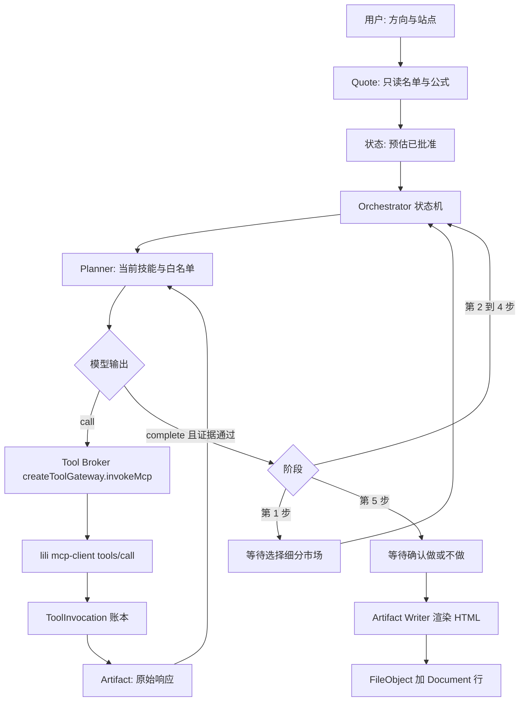

# ERP 内粒粒 MCP 开品工作流：代码实现设计

日期：2026-11-06。基线是 `codex/amazon-multistore-mcp` @ `a8995f3`（PR #6 已合并）。本文只规定后续代码怎么写。本 PR 不改业务代码、不新增迁移、不调用粒粒 / 卖家精灵 / 模型、不合并、不部署。

这是 [PR #8](https://github.com/75865162-eng/woker/pull/8) 阶段 Z（`docs/architecture/upgrade-plan.md` 的 7.6、7.7）在「从方向到开品文档」这一条用户流程上的实现设计。PR #8 仍是打开状态，其文件不在本基线里。本文不改那份评审，也不另起一套绕过 `createToolGateway` 的执行器。

相关现况文档：

- `docs/ai-mcp-erp-collaboration-upgrade-todo-2026-11-06.md`：C01–C09 为本地离线实现，C10–C11 未做。
- `docs/ai-mcp-erp-collaboration-batch3-2026-11-06.md`：Amazon MCP 已从 `invokeAmazonMcp` 进入 `createToolGateway.invokeMcp`。
- `docs/lili-integration-plan-2026-11-06.md`、`docs/lili-local-routing.md`：`/lili` 是主应用里的技能目录，不是粒粒 MCP 服务。

仓库里没有名为 StudyLab 的模块。技能、工具、工作流的离线目录就是 `src/data/lili/` 加 `src/lib/lili/catalog.ts`。

## 验收用的用户 prompt

工作流定义固定为目录里的第 5 条中文工作流（`src/data/lili/workflows-zh.json` 的 `index: 5`，标题「从选品到开品文档」）。实现时整段原文入库，供页面展示和测试比对，不改写技能名和停顿点：

> 使用粒粒 MCP，帮我从一个大方向做到开品文档。我想做的方向是：【填你的方向】。按下面的顺序来：
> 1. 用 amazon-niche-finder 在这个方向里找 3 到 5 个有需求、竞争可承受的细分市场，说明每个的依据。
> 2. 我选定一个后，用 amazon-product-research 把它研究透：需求规模、竞争格局、价格带、进入门槛。
> 3. 用 amazon-review-analyzer 分析头部竞品的差评，整理成痛点清单，按改良价值排序。
> 4. 用 tariff-calculator-amazon 算从中国发到目标站点的关税和到岸成本。
> 5. 用 amazon-product-selection 给候选产品打分并做利润测算，给出做或不做的结论。
>
> 第 1 步和第 5 步做完后停下来等我确认。这个流程会调用付费的市场数据，开始前先告诉我大概要调用多少次。最后产出一份 HTML 开品文档：卖点、规格、目标成本、改良点和验收标准。

用户在 ERP 里配好模型密钥和粒粒 MCP 凭证后，输入方向和目标站点，点击「预估并启动」。服务端按固定阶段真实调用粒粒 MCP。第 1 步结束后等用户选一个细分市场。第 5 步结束后等用户确认做或不做。终稿是 HTML。文档、参数和原始 evidence 可以再打开。

做到和 Codex 一样能看见：工具名、参数、返回、数据源、执行记录。模型按技能名写出来的文字，没有对应的工具调用记录，不能当作调研结果。

## 和阶段 Z 的融合

| 阶段 Z 原文 | 本工作流怎么落地 |
| --- | --- |
| 7.6 不新建第二套执行器，调用走 `createToolGateway` | 粒粒 `tools/call` 只出现在 gateway `execute` 回调里。Planner 和页面都不 `fetch` MCP |
| 7.6 `data_*` 保持现有注册表；`data_sync_start` 仍只创建申请 | 本店证据走现有 `invokeAmazonMcp`。默认开品 prompt 不调用它们 |
| 7.6 密钥不进 `AiModelSetting.settings`，接口只返回 `configured` | 粒粒凭证用 `ExternalIntegrationSetting`，`provider = "lili-mcp"`，和 `sellersprite-mcp` 分行 |
| 7.6 默认关闭，按工作区计次，超限拒绝，不伪造数据 | 见第 5 节。单价未知时仍按次数硬限 |
| 7.7 工具结果收成无脚本 HTML，缺数保持 null，跨工作区 404 | 见第 6 节。存储走现有 `FileObject`，另加可查询的 Document 行 |
| D13 开放问题 1：市场 MCP 是卖家精灵还是多宝鱼 | **本工作流的市场调用目标是粒粒 MCP。** 卖家精灵适配器继续只服务现有 Market Agent 和 `/agents/selection-research` 的 live 模式，不把那条传输标成粒粒 |
| D14 Gateway 尚未在生产验证 | P0–P3 用 fixture。P4 的真实调用由持有凭证的人触发，CI 不调用 |
| 开放问题 2：配额按次数还是金额 | 本工作流两者都记账：次数是硬限；金额只有配置了单价才有数，否则 `unitCost` 为 null |

不在本系列里做的阶段 Z 事项：不改 `/api/mcp/amazon` 的旧工具名，不把内部 Agent 工具整表导出，不让模型写 `ProductRecord`，不让模型确认 Amazon 出价，不把卖家精灵 token 复制进模型 JSON。

## 1. 现状盘点

盘点范围是 `a8995f3` 上的源码。下面每一条都能在该提交里打开。

### 1.1 `createToolGateway`

文件：`src/lib/agent-platform/tool-gateway.ts`。

`createToolGateway({ tools, adapters, clock })` 返回两个入口：

- `invoke`：按 `toolId` 查 `AgentToolDefinition`，检查 `enabled`、`canAgentUseTool`、`requiresApproval`。缺审批时返回 `APPROVAL_REQUIRED` 和一份审批请求，不执行。然后找 `adapterId` 对应的 `AgentToolAdapter.execute`，按 `retryPolicy` 重试，用 `withTimeout` 限时。
- `invokeMcp`：不依赖 Agent 定义。校验调用方传入的 input/output JSON Schema（类型、required、enum、长度、`additionalProperties: false`、anyOf/allOf/if）。`timeoutMs` 必须是 1 到 60000 的整数。超时和外部 `AbortSignal` 都会 `abort` 传给 `execute` 的子 signal。输出不符合 schema 抛 `INVALID_OUTPUT`。

已接入的调用方：

- `src/lib/amazon-sync/mcp.ts` 的 `amazonMcpGateway = createToolGateway({ tools: [], adapters: [] })`，`invokeAmazonMcp` 只使用 `invokeMcp`，超时 15000ms。权限、店铺范围和审计在 `execute` 前后，不在 gateway 的 agent 表里。
- `src/lib/agent-platform/runtime.ts` 用 `invoke` 跑内部 Agent 工具。

缺口，实现时要补在调用方，不要假装 gateway 已经有：

- `invoke` 的 `withTimeout` 只拒绝外层 Promise，不把 abort 传进 adapter。付费 MCP 必须走 `invokeMcp`，才能把取消传到 socket。
- gateway 不记账、不幂等、不识别租户。这些放在本工作流的 invocation 账本里，写库成功之后才进入 `execute`。
- `invoke` 的重试会再次调用 adapter。付费读不能用这个默认重试。
- 生产上 Prisma 取消和真实 MCP 超时尚未按 C06 的原文闭环。本工作流只承诺：超时后账本变为 `UNKNOWN`，不自动再打一次。

### 1.2 `data_*` 有两套同名工具

**ERP Amazon MCP**（`src/lib/amazon-sync/mcp-tool-registry.ts` 19–23 行）已注册并可调用：

| 工具 | 行为 |
| --- | --- |
| `data_list_tables` | 列出当前授权范围内已发布的逻辑表 |
| `data_describe_table` | 字段、粒度、限制 |
| `data_query` | 分页查询已发布数据。输入是 module/dataType 或兼容 table，**没有 SQL** |
| `data_sync_status` | 同步状态 |
| `data_sync_start` | 只创建 `REQUESTED` 申请，不启动同步 |

逻辑表现在覆盖 inventory、listings、sales_traffic_daily、ads_report_daily。这是本店已同步快照，不是外部市场数据。

**粒粒离线目录**（`src/data/lili/tools.json`，107 个工具）里也有这五个名字，语义不同：

| 目录工具 | 目录里的输入 | 目录描述 |
| --- | --- | --- |
| `data_list_tables` | 无必填 | 粒粒侧店铺抽取里的 SQL 表 |
| `data_describe_table` | `table` | 为写 SQL 看列 |
| `data_query` | 必填 `sql` | 对粒粒侧 DuckDB 抽取执行只读 SQL |
| `data_sync_status` | 无 | 粒粒侧同步状态 |
| `data_sync_start` | 无 | `readOnlyHint` 为 false，会在粒粒侧启动同步 |

同名不能互调。开品工作流禁止把技能正文里的 `data_query` 交给 `invokeAmazonMcp`，也禁止把 Amazon 的 `data_query` 发给粒粒。目录版 `data_query` 要求自由 SQL，本工作流的工具白名单不收录它。目录版 `data_sync_start` 不是只读，不收录。

本店证据只在用户勾选「附带本店已同步数据」且调用者具备现有 `operations:view` 与 `amazon_data:view:mcp` 时，经 `invokeAmazonMcp` 调用 ERP 的 `data_list_tables` / `data_describe_table` / `data_query`。开品 prompt 本身不包含这条路径。模型不得因为技能里写了 `data_query` 就去查本店或编造本店数字。

### 1.3 `market_*` 现有适配器是卖家精灵，不是粒粒

`src/lib/integrations/sellersprite.ts`：

- provider 常量 `sellersprite-mcp`。
- 默认 `serverUrl: ""`，`enabled: false`，`protocolVersion: "streamableHttp"`。地址由用户填写，仓库没有默认生产 URL。
- 传输是 streamable HTTP：`initialize`、`notifications/initialized`、分页 `tools/list`、`tools/call`。协议版本非法时回退 `2024-11-05`。本地只允许 `localhost` / `127.0.0.1` / `[::1]` 的 http。响应体上限 8MB。正文若回显 apiKey 则拒绝。
- 213–223 行把内部工具 id 别名到远程名，例如 `sellersprite.market.search` → `market_find_products` 等。

`src/lib/agent-platform/market.ts` 的 Market Agent 使用 adapter `sellersprite-mcp-adapter`，工具 id 是 `sellersprite.market.search` 这一组，不是粒粒技能 slug。

`src/lib/selection-research/` 已经实现了同一条五技能顺序（`types.ts` 的 `SKILLS` 与本文五个 slug 一致），并且第 1 步、第 5 步会停下。这条链路的 live 模式在 `server.ts` 里固定为 `createSellerSpriteResearchTransport`。`engine.ts` 把非 fixture 的调用记成 `service: "sellersprite"`。fixture 模式把 `service` 写成 `"lili"`，但传输是进程内样本，没有 MCP。

因此：选品研究页 `/agents/selection-research` 今天不能算「ERP 里调用了粒粒 MCP」。本设计不改它的 live 供应商，避免把已有卖家精灵运行改道。

### 1.4 粒粒 MCP 的 endpoint 和工具名

仓库里有的：

- 离线目录：`src/data/lili/tools.json`（107）、`skills.json`（116）、`skill-bodies.json`、`workflows-zh.json`。`source-manifest.json` 记录抓取日 `2026-11-06`，来源目录是本机 `/Users/chenjieliang/Documents/lili`，不是一个 URL。
- 目录执行器 `src/lib/lili/tool-execution.ts` 的 `runCatalogTool` 只实现 `meta_search_skills`、`meta_load_skill`、`meta_list_workflows`。其余工具，包括全部 `market_*`，返回 HTTP 501，`error` 为 `tool_adapter_not_mapped` 或 `live_write_unsupported`。它不发起 MCP。
- 协议客户端 `src/lib/selection-research/lili-transport.ts` 的 `createLiliTransport({ endpoint, authorization })` 会做 `initialize`（客户端声明 `2025-06-18`）、`tools/list` 游标、`tools/call`，并拒绝密钥回显。调用方必须传入 endpoint。全仓库唯一的构造点在 `tests/selection-research.test.ts`，指向 `http://127.0.0.1:9999/api/mcp`。没有任何环境变量、设置行或默认 URL。
- 西柚是另一个供应商。`src/lib/lili/tool-config.ts` 把地址固定为 `https://mcp.xydc.com/mcp`，provider `xiyou_mcp`。选品研究发现接口把它标成 `unavailable_no_ERP_provider_adapter`。西柚不是粒粒。

仓库里没有的：

- 粒粒 MCP 的生产 endpoint。
- 粒粒 token 的存储行。`ExternalIntegrationSetting` 今天只有卖家精灵那一类配置读写（`src/lib/server/integration-settings.ts`）。
- 一份「已经从线上 `tools/list` 抓回来」的 manifest。`tools.json` 是目录快照。技能正文里的工具名在这份快照里对得上，不等于线上服务现在仍暴露这些名字和 schema。

所以 P0 要新增 `src/lib/lili/mcp-client.ts`。工具名单以运行时 `tools/list` 为准。目录 JSON 只作为技能提示和 fixture 对照，不能标成已实现。

目录快照里和本流程相关的市场工具（全部 `readOnlyHint: true`）以及目录描述里写明的费用口径：

| 目录工具名 | 必填 | 目录描述中的费用口径 |
| --- | --- | --- |
| `market_find_node` | `query` | 每次调用消耗 credits |
| `market_scan_node` | `node_id_path` | 一次 MCP 调用内部可能拆成多段；正文写默认约 5 个 credit 当量，带品牌/卖家时约 7。样本是节点头部 listing，不是全节点 |
| `market_find_products` | 无（有 `keyword`、`marketplace`、价格/销量区间、`node_id_path`、分页） | 每次调用消耗 credits。`filters_json` 被描述为卖家精灵 product_research 的透传字段 |
| `market_research_keyword` | `keywords` | 每次调用消耗 credits，正文写数据来自 SellerSprite |
| `market_mine_keywords` | `keyword` | 目录有此工具，五个技能的 `tools` 数组未列入 |
| `market_get_asin` | `asin` | 单个 ASIN 详情 |
| `market_get_reviews` | `asin`；`stars` 可选，例如 `1,2` | 每次调用消耗 credits |
| `market_list_competitors` | `asin` | 每次调用消耗 credits。五个技能的 `tools` 数组未列入，评论技能的使用说明依赖它来找竞品 |
| `market_aba_trend` | `keyword` | 技能数组未列入 |
| `competitor_find_similar` | `asins` | 目录写的是 Amazon 相似品，enrich 后带标题和排名 |
| `finance_get_fee_estimate` | 无；描述要求 `asin` 或 `sku` 加 `price` | 亚马逊 Product Fees 的事前佣金/FBA 估算。返回不含仓储、广告、退货、采购。**不是关税表** |

这些描述同时说明两件事：目录作者把市场数据的上游写成了卖家精灵；ERP 里的 `sellersprite-mcp` 适配器仍然是另一条连接。用户要求的调用栈是「ERP → 粒粒 MCP」。粒粒服务内部再向谁买数，由粒粒响应里的来源字段记录，不通过把 ERP 卖家精灵客户端改名为粒粒来完成。

`market_find_products` 的目录描述开头是抽样器（sampler），`market_scan_node` 写明数字来自节点样本。即使真实 `tools/call` 成功，报告也要把这个样本范围写出来，不能把样本说成全类目普查。

### 1.5 AI 密钥和模型配置

复用现有用户级配置，不新建模型表：

- 表 `AiModelSetting`：唯一键 `organizationId + workspaceId + userId`。`settings` 和 `profiles` 是 JSON。
- 类型 `src/lib/ai-settings.ts` 的 `AiModelSettings`：`enabled`、`provider`、`apiKey`、`baseUrl`、`model`、`wireApi`（`chat_completions` | `responses` | `image_generations`）、`timeoutSeconds`。
- 服务端解析：`src/lib/server/user-ai-settings.ts` 的 `resolveUserAiTextSettings`。没有用户密钥时 `src/lib/server/ai-runtime.ts` 的 `resolveAiSettings` 才回退环境变量。工作流只使用当前用户、当前工作区已经保存的文本配置，不用进程环境变量顶替，避免串到别人的 key。
- 出站：`buildAiTextEndpoint` 在 `chat_completions` 时请求 `{baseUrl}/chat/completions`，否则走 Responses。`buildAiRequestHeaders` 把 key 放在 `Authorization`。实际请求经 `src/lib/server/ai-fetch.ts`。
- 公开接口只暴露 `hasApiKey`。日志延续现有红线：不回显 key、Authorization 或长响应体。

现有选品研究的模型调用在 `src/lib/selection-research/ai-agent.ts`。它发送一条 JSON 指令，要求模型输出 `call` 或 `complete`。请求体没有 `tools` 字段。`chat_completions` 使用 `response_format: json_object`；`responses` 使用 `text.format.type = json_object`。这是今天唯一已经写好的「模型选择工具、服务端执行」协议，而且它还没有接到粒粒。

### 1.6 五个技能是提示词，不是工具

`src/lib/lili/catalog.ts` 的 `CatalogSkill.tools` 来自 `skills.json`，是字符串列表。`skillMarkdown` 返回 `skill-bodies.json` 里的 Markdown。`listWorkflows` 用正则从步骤句子里抽出 slug。没有任何函数把 `amazon-niche-finder` 当作可 `tools/call` 的名字。

五个技能在目录里的 `tools` 数组：

| 顺序 | slug | 目录 `tools` | 正文里出现、但不在 `tools.json` 的名字 |
| --- | --- | --- | --- |
| 1 | `amazon-niche-finder` | `market_find_products`、`market_find_node`、`market_scan_node` | `web_fetch` |
| 2 | `amazon-product-research` | `market_find_products`、`market_get_asin`、`market_research_keyword` | `web_search`、`web_fetch` |
| 3 | `amazon-review-analyzer` | `market_get_reviews`、`market_get_asin`、`competitor_find_similar` | 无 |
| 4 | `tariff-calculator-amazon` | `finance_get_fee_estimate`、`market_get_asin`、`data_query` | 无。`data_query` 在目录里是 SQL |
| 5 | `amazon-product-selection` | `market_find_products`、`finance_get_fee_estimate`、`market_get_reviews` | `web_search`、`web_fetch` |

`skills.json` 里这五条的 `stepsZh` 仍是目录通用句：「用沙盒里的样本市场数据……并标明不是真实行情」。那是离线手册的自我声明，不是本工作流的执行许可。运行时系统提示要写明：手册中的沙盒句不能被抄进报告当数据；数字只能来自本工作流账本里的成功调用。

`web_search` / `web_fetch` 不在 107 个目录工具里。在线上 manifest 出现并被审过只读 schema 之前，白名单不包含它们。模型提到这两个名字时，编排器记 `BLOCKED`，不发网。

分层：

- **SkillDefinition**：slug、顺序、停顿点、Markdown 快照和 sha256、候选工具名。来自目录，运行开始时冻结在工作流行里。
- **ToolRegistry**：某次 `tools/list` 的名字、描述、inputSchema、`readOnlyHint`、抓取时间。只放只读且命中白名单的工具。
- **SkillRunner**：把当前 SkillDefinition、当前阶段允许的 ToolRegistry 子集、已有 evidence 交给模型。模型只能在这个子集里点名。真正的 `tools/call` 由 Tool Broker 执行，并把工具名、参数、返回、上游、耗时写入账本。

SkillRunner 不调用 `runCatalogTool` 来假装市场数据。`meta_load_skill` 在 ERP 内由 `skillMarkdown` 本地完成，不为此打粒粒。

## 2. 总体技术原理

四段职责分开。

**AI Planner。** 有能力按指令选择工具的模型调用。输入是用户方向、目标站点、当前技能快照、本阶段 ToolRegistry 子集、已有 evidence 的短引用。输出是一个工具调用，或一份带 evidence id 的阶段结果。它不知道预算余额的原始凭证，也不能决定跳过第 1 步或第 5 步的人工停顿。

**Deterministic Orchestrator。** 服务端状态机。它决定阶段能否进入、是否必须等人、工具是否在白名单、账本里是否已经有同参数调用、预算是否还够。模型返回「进入第 3 步」或「用户已经同意」时，编排器不采信，只看数据库里的状态和审批行。

**Tool Broker。** `createToolGateway.invokeMcp`。`execute` 里调用 `src/lib/lili/mcp-client.ts`。每次调用带工作区身份、只读 schema、不超过 60 秒的超时、幂等键、预算预留和审计。本店 `data_*` 不走这个客户端，走现有 `invokeAmazonMcp`。

**Artifact Writer。** 工具原始响应先落 evidence。之后的模型只能引用这些 evidence 来写格式化段落。缺失和 null 保持原样。报告渲染器不发模型请求，只把已通过校验的阶段结果和 evidence 收成 HTML。



### 状态机

工作流状态由编排器写入。页面只展示。

| 状态 | 谁可以写入 | 进入条件 | 退出 |
| --- | --- | --- | --- |
| `DRAFT` | 创建 API | 方向、站点通过长度校验；尚未预估 | 算出预估 |
| `AWAITING_ESTIMATE` | Quote | 预估已保存，付费工具零次调用 | 用户批准，或用户取消 |
| `RUNNING` | Orchestrator | 预估批准存在；当前步不是人工门；没有 `IN_FLIGHT` / `UNKNOWN` | 一步完成、失败、阻断、取消 |
| `AWAITING_NICHE` | Orchestrator | 第 1 步结果含 3 到 5 个带 id 的候选，且每条依据有成功调用 id | 用户选择的 id 属于该结果 |
| `AWAITING_VERDICT` | Orchestrator | 第 5 步结果含 `GO` / `NO_GO` / `NEEDS_VALIDATION`，且结论引用的 evidence 都在账本 | 用户确认或驳回重跑第 5 步 |
| `REPORT_READY` | Report | 两个人工门都有决策行，HTML 已写入 FileObject | 用户归档后变为 `ARCHIVED` |
| `BLOCKED` | Orchestrator | 本阶段必需工具不在 manifest、无权限、预算用尽、模型协议不匹配 | 用户补配置后从原阶段继续；不自动改参数重打已成功的调用 |
| `FAILED` | Orchestrator | 模型输出无法解析、输出 schema 失败、或明确的工具错误 | 只允许显式恢复。不自动重试 |
| `CANCELLED` | 用户 API | 取消信号已记下 | 终态。在途调用收成 `UNKNOWN`，不补打 |

阶段内还有调用状态：`RESERVED` → `IN_FLIGHT` → `SUCCEEDED` | `FAILED` | `UNKNOWN` | `CANCELLED`。`RESERVED` 在出网前落库。进程死在出网之后，恢复时把仍为 `IN_FLIGHT` 的行改成 `UNKNOWN` 并停机，这条规则直接沿用 `src/lib/selection-research/engine.ts` 里已经写明的做法。

人工门只有数据库决策能通过：

1. `estimateApproval`：批准的是某次 quote 的哈希。哈希变了必须重新批准。
2. `nicheSelection`：`candidateId` 必须出现在第 1 步结果里。
3. `verdictReview`：确认第 5 步的做 / 不做 / 待验证。报告渲染同时要求这两次人工门，和第 1 步停顿分开检查。

模型文本、前端隐藏按钮、query 参数都不能写这三行。

和现有选品研究引擎的差别，实现时保持住：

- 选品研究 live 在每次 `tools/call` 前再停一次 `MCP_CALL`。本工作流按用户 prompt，只在开工前做一次次数预估，加上第 1 步和第 5 步两道门。次数硬顶仍然生效。
- 选品研究把整份 Run 放在 `AgentExecution.output`。本工作流要按次查询、按幂等键去重，使用下面的独立表，不把新字段塞进 Agent 平台那张共享表。

## 3. 模块和文件落点

每个新文件控制在大约 50–200 行。超出就拆，不把编排和 HTTP 写进同一个文件。

### 3.1 新文件

| 文件 | 行数量级 | 职责 |
| --- | --- | --- |
| `src/lib/lili/mcp-client.ts` | 150–200 | 从 `createLiliTransport` 抽出的粒粒客户端。见下一小节 |
| `src/lib/lili/mcp-settings.ts` | 80–120 | `provider = "lili-mcp"` 的解析、公开字段、合并。形态对齐 `SellerSpriteMcpSettings`，不读取卖家精灵行 |
| `src/lib/ai-product-workflow/definitions.ts` | 120–180 | 五个 SkillDefinition、白名单、阶段停顿、目录工具只标 `CATALOG_ONLY` |
| `src/lib/ai-product-workflow/quote.ts` | 120–180 | 纯函数。不发网。按 manifest 有无和公式算次数与 null 单价 |
| `src/lib/ai-product-workflow/orchestrator.ts` | 180–200 | 状态迁移、三道门、预算、幂等、取消。不含 HTTP、不含模型 SDK |
| `src/lib/ai-product-workflow/runner.ts` | 150–200 | SkillRunner。组 Planner 上下文，解析模型输出，拒绝证据不够的 complete |
| `src/lib/ai-product-workflow/planner.ts` | 120–160 | 唯一的模型出站。按第 4 节的协议分支 |
| `src/lib/ai-product-workflow/broker.ts` | 80–120 | 组装 `invokeMcp`。`execute` 调 mcp-client 或 fixture |
| `src/lib/ai-product-workflow/evidence.ts` | 100–150 | 原始响应截断、哈希、null 保留、敏感字段剔除 |
| `src/lib/ai-product-workflow/report.ts` | 150–200 | 服务端 HTML。无脚本、无外链 |
| `src/lib/ai-product-workflow/store.ts` | 150–200 | Prisma 读写、租户条件、乐观锁 |
| `src/app/api/ai-product-workflows/route.ts` | 80–120 | `GET` 列表，`POST` 创建并返回预估 |
| `src/app/api/ai-product-workflows/[id]/route.ts` | 80–120 | `GET` 状态快照。轮询用这一份 |
| `src/app/api/ai-product-workflows/[id]/estimate/route.ts` | 60–100 | `POST` 重算。不调用付费工具 |
| `src/app/api/ai-product-workflows/[id]/confirm/route.ts` | 80–120 | 三种确认的唯一写入口 |
| `src/app/api/ai-product-workflows/[id]/report/route.ts` | 60–100 | 渲染并保存；下载走带授权的 FileObject |
| `src/app/ai-product-workflows/page.tsx` | 80–120 | 列表和启动表单 |
| `src/app/ai-product-workflows/[id]/page.tsx` | 150–200 | 预估、时间线、工具日志、两道复审 |
| `tests/fixtures/lili-mcp/` | 若干 JSON | 脱敏 JSON-RPC。带 `fixture: true`，live 模式拒绝 |
| `tests/ai-product-workflow.test.ts` | 既有测试风格 | 状态机、预估、幂等、报告约束 |

`src/lib/selection-research/lili-transport.ts` 在 P0 改为调用 `mcp-client` 的解析函数，或从那里再导出 `createLiliTransport`。选品研究测试仍指向本地假端点。不在 P0 把选品研究的 live 传输换成粒粒。

### 3.2 `mcp-client.ts`

职责限定为协议，不含业务阶段：

- 入参 `endpoint`、`authorization`、`fetch`、`timeoutMs`、`signal`。
- URL 规则与现有 `createLiliTransport` 相同：https；http 仅限本机；禁止用户名、密码、query、hash。
- `Accept: application/json, text/event-stream`。解析 JSON 或 SSE 里匹配 id 的 JSON-RPC。这就是目录和现有客户端所说的 streamable HTTP。
- `initialize` 保存 `mcp-session-id` 与 `mcp-protocol-version`。会话只留在这次客户端实例里，不进数据库。
- `listTools` 跟随 `nextCursor`，游标重复或超过 100 页即失败。
- `callTool` 返回完整信封，不把文本内容改写成「看起来像 JSON 的结论」。
- 响应超过 8MB、HTTP 非 2xx、回显 token、工具定义缺 `name` 或 `inputSchema`：抛稳定错误码，错误对象里没有 Authorization。
- token 只出现在请求头。日志参数是调用方事先准备的 safe snapshot。

失败不重试。超时由 gateway 的子 signal 触发，客户端看到 abort 后停止读 body。

### 3.3 改造的现有文件

| 文件 | 改动 |
| --- | --- |
| `src/lib/server/integration-settings.ts` | 增加粒粒配置的读写，沿用同一张 `ExternalIntegrationSetting`。公开 DTO 只有 `configured`、`hasToken`、`serverUrl`、`enabled` |
| `src/lib/accounts/permissions.ts` | `agents` 模块的 `paths` 加上 `/ai-product-workflows`。不新增权限模块。API 使用 `requireApiPermission("agents", "view" \| "create")` |
| `src/components/app-shell/app-shell-client.tsx` | 在粒粒技能中心旁加「开品工作流」入口，`moduleId: "agents"` |
| `prisma/schema.prisma` 加一张新迁移 | 只加第 3.4 节的表。不改 `AgentExecution`、`AgentToolCall`、`AiModelSetting` |

`/lili` 目录页、`runCatalogTool`、卖家精灵设置页保持原行为。设置页可以加一块粒粒凭证表单，保存走上面的 integration helper。凭证不进 `/lili/v2/tool-config` 的西柚表单。

身份沿用现有工作区边界：`requireApiPermission` 加上 `workspaceScopeFromRequest` 和 `assertWorkspaceAccess`。所有查询带 `organizationId`、`workspaceId`、`requestedByUserId`。跨工作区返回 404，不返回别的租户是否存在。

### 3.4 表

加法迁移。主键 `cuid`。时间用 `timestamptz`。JSON 用 Prisma `Json`。

**AiProductWorkflow**

| 列 | 用途 |
| --- | --- |
| `id` | 主键 |
| `organizationId`、`workspaceId`、`requestedByUserId` | 与 `AgentExecution` 相同的租户和所有权 |
| `direction` | 用户方向，最长 2000 |
| `marketplace` | 目标站点，大写，如 `US` |
| `constraints` | 可选 JSON：价格带、成本假设、是否附带本店证据 |
| `modelProfileId` | 指向该用户 `AiModelSetting` 里的 profile id。不复制 apiKey |
| `skillSnapshot` | 五个技能的 slug、sha256、markdown 哈希 |
| `quote`、`quoteHash` | 最近一次预估和哈希 |
| `status` | 第 2 节的状态 |
| `stage` | 1–5 |
| `selectedCandidateId` | 第 1 步选中的 id |
| `verdict` | 第 5 步结论 |
| `budgetReservedCalls`、`budgetSpentCalls` | 整数。未知单价也计次 |
| `budgetReservedCost`、`budgetSpentCost` | 整数分。没有单价时保持 null，不用 0 表示未知 |
| `manifestId` | 本工作流冻结的工具名单 |
| `revision` | 乐观锁 |
| `cancelRequestedAt` | 取消传播 |

索引：`(organizationId, workspaceId, createdAt)`，`(organizationId, workspaceId, status)`，`(organizationId, workspaceId, requestedByUserId, createdAt)`。

**AiProductWorkflowStep**

唯一 `(workflowId, stage)`。列：`skillSlug`、`status`（`PENDING` `RUNNING` `AWAITING_USER` `SUCCEEDED` `FAILED` `BLOCKED`）、`result` JSON、`startedAt`、`finishedAt`。`result` 只存校验后的阶段结构，不存密钥。

**AiProductToolInvocation**

| 列 | 用途 |
| --- | --- |
| `id` | 对外的 `toolCallId` |
| `workflowId`、`stage`、`skillSlug` | 归属 |
| `idempotencyKey` | `stage + toolName + canonicalArgsHash`。唯一 |
| `toolName` | 线上工具名 |
| `argsSnapshot` | 已剔除密钥的参数 |
| `argsHash` | 幂等 |
| `status` | `RESERVED` `IN_FLIGHT` `SUCCEEDED` `FAILED` `UNKNOWN` `CANCELLED` |
| `upstream` | 固定 `lili` 或 `amazon-mcp`。不写 `sellersprite`，除非响应正文自己带了来源句子，那句话放进 `dataSource` |
| `dataSource` | 从响应安全摘出的来源说明，没有则为 null |
| `requestId` | 本系统生成的 UUID，写入审计，也作为 JSON-RPC id |
| `outputRef` | evidence 行 id。大响应不进这条 JSON |
| `outputSnapshot` | 截断后的安全摘要，上限 16KB |
| `startedAt`、`finishedAt`、`latencyMs` | 执行记录 |
| `billing` | `NOT_CHARGED`（未出网）`UNPRICED` `UNKNOWN` `CONFIRMED` |
| `reservedCalls` | 出网前为 1 |
| `errorCode` | 稳定码，无响应正文 |

索引：唯一 `(workflowId, idempotencyKey)`，`(workflowId, status)`，`(workflowId, stage, createdAt)`。

**AiProductWorkflowDocument**

`kind`：`manifest` | `evidence` | `stage_result` | `report_html`。`fileObjectId` 可空（manifest 可以只在 JSON 列）。`sha256`、`capturedAt`。报告行在渲染成功后不可更新，要重出则新行。索引 `(organizationId, workspaceId, workflowId, kind)`。

**AiProductToolManifest**

`workflow` 可共享同一用户最近一次成功的 `tools/list`，但每个工作流记录自己采用的 `manifestId` 和 schema 哈希。列：`organizationId`、`workspaceId`、`userId`、`fetchedAt`、`tools` JSON（名字、schema、readOnly）、`truncated`。token 不在此表。

预估批准、细分市场选择、结论确认三行放在 **AiProductWorkflowDecision**：`kind`（`ESTIMATE` `NICHE` `VERDICT`）、`gateRevision`、`payload` JSON、`actorUserId`、`createdAt`。唯一 `(workflowId, kind, gateRevision)`，防止重复提交改写历史。驳回第 5 步会把 `gateRevision` 加一，旧确认行保留。

生产迁移沿用阶段 Z 的依赖：阶段 W 的临时库 dry-run 先于这张表上 123。本文的 PR 不执行迁移。

### 3.5 页面怎么知道进度

采用 **2 秒轮询** `GET /api/ai-product-workflows/[id]`，不用 SSE。

理由：

- 人工门会把工作流停住几分钟到几天。2 秒刷新足够看到工具日志，也不必维持一条长连接。
- `invokeMcp` 的上限是 60 秒，一个阶段有多次调用。SSE 会把整段执行绑在一条经过 Caddy 的 HTTP 响应上。
- 现有赛狐日志和选品研究页面已经是按 id 读取状态。本页沿用同一种快照，不引入新的推送协议。
- 快照里带 `revision`、当前阶段、最近 50 条 invocation 摘要。轮询不宣称亚秒实时。

执行方式同样避免长连接：浏览器在状态为 `RUNNING` 时附带调用 `POST .../[id]/tick`，服务端每个 tick 只做一轮模型决策或一次工具调用，然后返回。关掉页面不会继续烧后续调用。已经出网的那一次在下次打开时对账为 `UNKNOWN`，不自动重打。P4 若实测 tick 被代理掐断，再考虑挂到现有 worker；那是后续 PR 的事，不在本设计里假装已经有队列。

## 4. AI / MCP 契约

线上 manifest 没抓到的工具，状态写 `CATALOG_ONLY` 或 `MISSING`。页面用这个词。代码路径不能返回 `IMPLEMENTED`。

白名单（只有 live manifest 里同名、`readOnlyHint !== false`、且 inputSchema 能通过 gateway 校验时才可调用）：

`market_find_node`、`market_scan_node`、`market_find_products`、`market_research_keyword`、`market_get_asin`、`market_get_reviews`、`market_list_competitors`、`competitor_find_similar`、`finance_get_fee_estimate`。

`market_mine_keywords`、`market_aba_trend` 在目录里，不在五个技能的 `tools` 数组里。默认不进阶段子集。以后若技能快照改了再单开一版定义。

`data_query`、`data_sync_start`、`web_search`、`web_fetch` 不在白名单。

### 4.1 分步合同

输出里的数字字段允许 null。模型补上的数字若没有 evidence id，校验失败，阶段记 `FAILED`，不落报告。

**第 1 步 `amazon-niche-finder`。** 停顿。

- 输入：`direction`、`marketplace`、可选价格带。
- 候选工具：`market_find_node`、`market_scan_node`、`market_find_products`。三者缺一则该细分的对应维度为 null，并在结果里列缺失工具名。三个都不在 manifest：整步 `BLOCKED`，不生成候选。
- 输出：`candidates` 长度 3–5。每项 `id`、`name`、`rationale`、`evidenceIds`。`rationale` 里的需求或竞争句必须是 `observed` 或明确的 `assumption`。
- 不确定：目录写明 scan 是头部样本。结果里保留 `sampleScope: "head_listings" | "unknown"`，不把样本改写成全市场。

**第 2 步 `amazon-product-research`。** 不停顿。只研究第 1 步选中的那个 id。

- 输入：选中候选的名字、站点、第 1 步 evidence 引用。
- 候选工具：`market_find_products`、`market_get_asin`、`market_research_keyword`。头部竞品列表若需要，允许同阶段调用 `market_list_competitors`（目录有、技能数组没有，本设计把它补进第 2 步子集，因为第 3 步的评论对象否则没有来源）。manifest 没有该工具时，竞品列表为 null，第 3 步只能分析用户在约束里手填的 ASIN；没有手填则第 3 步 `BLOCKED`。
- 输出：`demand`、`competition`、`priceBand`、`entryBarrier`。每个字段是 `{ value, unit, kind, evidenceIds }` 或整段 null。
- 不确定：搜索量、集中度、价格带对不上同一次调用时分字段保留，不合成一个「竞争适中」而不附 id。

**第 3 步 `amazon-review-analyzer`。** 不停顿。

- 输入：第 2 步的头部 ASIN，默认最多 3 个，硬顶 5 个。
- 候选工具：`market_get_reviews`（`stars` 分别为低星和高星各一次，沿用选品研究「两极都要有，否则写明不可用」）、`market_get_asin`、`competitor_find_similar`。
- 输出：`pains[]`，字段 `text`、`asin`、`starFilter`、`mentionCount`（响应里没有计数则为 null，不按模型感觉填）、`improvementValueRank`、`evidenceIds`。
- 不确定：工具失败的 ASIN 留在 `missingAsins`，不把其他 ASIN 的差评挪过来。

**第 4 步 `tariff-calculator-amazon`。** 不停顿。

- 输入：发货地固定文案「中国」、目的站点、可选申报价和重量。这些是用户约束，不是工具结果。
- 候选工具：`finance_get_fee_estimate` 只提供亚马逊佣金和 FBA 估算，schema 里没有 HS 编码和关税率。`market_get_asin` 只复用价格。目录中的 `data_query` 不调用。
- 输出：`duty`、`landedCost`、`amazonFees`、`assumptions[]`。在 live manifest 出现专门的关税工具并完成一次成功调用之前，`duty` 与 `landedCost` 的 `kind` 只能是 `assumption` 或 null，不能是 `observed`。`amazonFees` 只有 `finance_get_fee_estimate` 成功时才是 `observed`。
- 本步因此 **不能标成关税工具已实现**。报告标题写「关税：无已验证工具，以下为假设」。

**第 5 步 `amazon-product-selection`。** 停顿。

- 输入：前四步 evidence 引用、用户成本假设。
- 候选工具：只补前几步没有覆盖到的 `market_find_products`、`finance_get_fee_estimate`、`market_get_reviews`。同参数命中幂等则不再出网。
- 输出：`score`（null 表示证据不够，不打 0 分）、`profit` 公式、`verdict` 为 `GO` | `NO_GO` | `NEEDS_VALIDATION`。存在 `assumption` 或缺失关税工具时，不允许 `GO`。这和选品研究引擎 `GO_REQUIRES_RESOLVED_ASSUMPTIONS` 一致。
- 利润公式里的采购价、头程、广告、退货若没有来源，对应项为 null，利润为 null，结论用 `NEEDS_VALIDATION`。

CPC、CVR、退货率不在上述白名单的返回字段定义里。报告这三项固定为 unknown，除非用户打开了本店证据且 ERP `data_query` 的对应数据集真有该列。没有列就保持 null，不向粒粒 SQL 工具要。

### 4.2 调用记录示例

账本和 API 都用这一形。示例里的数字是结构说明，不是行情。

```json
{
  "toolCallId": "clxxxxxxxx",
  "workflowId": "clyyyyyyyy",
  "stage": 1,
  "skillSlug": "amazon-niche-finder",
  "toolName": "market_find_node",
  "argsSnapshot": { "marketplace": "US", "query": "pet water fountain" },
  "argsHash": "sha256:…",
  "outputSnapshot": {
    "nodeIdPath": null,
    "note": "摘要。完整响应在 outputRef"
  },
  "outputRef": "doc_evidence_1",
  "status": "SUCCEEDED",
  "startedAt": "2026-11-06T00:00:00.000Z",
  "finishedAt": "2026-11-06T00:00:01.200Z",
  "latencyMs": 1200,
  "upstream": "lili",
  "dataSource": null,
  "requestId": "2b6f0c2e-7c1a-4d5e-9f10-0a0b0c0d0e0f",
  "billing": "UNPRICED",
  "reservedCalls": 1
}
```

禁止出现的字段：token、Authorization、apiKey、cookie、模型密钥。`argsSnapshot` 经过与 `redactJson` 同类的键名过滤，再加一层「字符串值不得包含当前 token」的检查，命中则整段不落库并记 `UNSAFE_PAYLOAD`。

### 4.3 模型协议，按优先级

今天的代码只支持第 2 级。第 1 级要新写，而且只对一种协议。

1. **优先：OpenAI 兼容 Chat Completions 的 `tools`。** 条件是该 profile 的 `wireApi === "chat_completions"`，并且 profile 上显式 `toolCalling: "openai_tools"`。请求体在现有 `chat/completions` 上增加 `tools`（只含本阶段白名单和 live inputSchema）和 `tool_choice: "auto"`。解析 `choices[0].message.tool_calls[].function.arguments`。解析失败、arguments 不是对象、工具名不在子集内：本轮 `FAILED`，不把自然语言改写成一次成功调用。服务端执行后把工具结果以 `role: "tool"` 回传，直到模型给出阶段 JSON 或达到该阶段轮数上限（8）。
2. **默认：现有 JSON 动作协议。** `toolCalling` 缺省或为 `json_action`。实现复用 `createResearchAiAgent` 的请求形状：系统指令加一个只含 `call` 或 `complete` 的 JSON。`chat_completions` 与 `responses` 都能走这条，因为 `ai-runtime.ts` 已经为两者发 JSON 模式。服务端解析后仍由 Broker 执行。这不是模拟报告；没有账本记录的句子不会进报告。
3. **`text_only`。** 模型不选择工具。编排器按本阶段 quote 里的固定调用序列执行（参数来自用户输入和上一步结构化字段，不来自自由文本）。模型只在工具全部结束之后，把 evidence 收成段落。固定序列所需要的工具缺失时阶段 `BLOCKED`。
4. **不实现的协议。** `wireApi === "responses"` 时不发送 `tools`。`buildResponsesRequestOptions` 今天没有 tools 字段，本文不把它写成已支持 Responses 工具调用。`image_generations` 不能当 Planner。

Profile 增加 `toolCalling` 时，放在该用户已有的 profile JSON 里，默认 `json_action`，这样旧的测试聊天和选品研究行为不变。不在文档里宣称 DeepSeek、Kimi 或千问当前模型名已经开通了 tools。页面在启动前读 profile：`openai_tools` 走第 1 级，否则走第 2 级；若用户把 profile 标成 `text_only` 则走第 3 级。模型 HTTP 非 2xx、空内容、或内容含有 apiKey：错误码 `MODEL_UPSTREAM`，阶段失败，不用目录示例填报告。

内部 `data_*` 只在 `constraints.includeOwnStore === true` 时进入 Planner 的工具子集，并且 Broker 调 `invokeAmazonMcp`。权限失败是 `BLOCKED`，不是空数组冒充「店铺没有销量」。

## 5. 费用预估和审批

`POST /estimate` 与创建时的第一次预估：

- 不调用 `tools/call`。
- 不调用模型。
- 若该用户没有成功的 manifest，预估按目录候选计算，并标 `manifest: "catalog_unverified"`。每个工具一行 `availability: "CATALOG_ONLY"`。
- 若已有 manifest，只统计白名单交集，缺的工具次数为 0，并列出 `MISSING`。
- `unitCost` 只有在以后单独配置了价目时才有数。P1 的迁移不建价目表，因此这一阶段以及未配置时都是 null。目录正文里的 “Costs credits” 和 “5 credits” 只把该工具标成 `paid: true`，单价仍是 null。不把 5 写成金额。

刷新 manifest 是单独动作 `POST /api/ai-product-workflows/manifest`：只做 `initialize` + `tools/list`。它可能被供应商收费，所以单独记账，次数上限每天 3 次，`unitCost` 仍为 null。它不进入开品预估的市场次数。

### 5.1 可重算公式

符号：

- `N`：细分市场个数，预估取上界 5，下界 3。用户不能改出这个区间。
- `C`：第 2 步深入的候选产品数，上界 5。默认按上界估。
- `H`：头部竞品 ASIN 数，默认 3，硬顶 5。
- `present(name)`：manifest 或目录模式下该工具是否计入。目录模式全按 1，但行上标未验证。
- `maxParallel = 1`。付费调用串行。
- `rateLimitMs = 1200`。粒粒没有已核对的限频文档；用和赛狐客户端相同的下限作为保守间隔，避免一开场打满。这不是粒粒的官方配额。
- 同阶段同工具同参数的重复不计入预估上界之外的第二次。

| 阶段 | 上界（MCP `tools/call` 次数） | 下界 |
| --- | --- | --- |
| 1 找细分 | `present(find_node) + present(scan_node) * N + present(find_products)` | 把 `N` 换成 3 |
| 2 研究选中细分 | `present(find_products) + present(get_asin) * C + present(research_keyword) + present(list_competitors) * H` | `C = 3`，`H = 1` |
| 3 差评 | `present(get_reviews) * H * 2 + present(get_asin) * H + present(find_similar)` | 只对 1 个 ASIN 做两极评论，其余工具按有无 |
| 4 关税 / 到岸 | `present(fee_estimate)`，0 或 1。关税工具本身计 0 | 0 |
| 5 评分 | 仅补缺。上界 `present(fee_estimate) + present(get_reviews)`，与前面幂等相同时为 0 | 0 |

按目录工具都还在、取上界：第 1 步 `1 + 5 + 1 = 7`，第 2 步 `1 + 5 + 1 + 3 = 10`，第 3 步 `3 * 2 + 3 + 1 = 10`，第 4 步 `1`，第 5 步若费用和评论都已打过则为 `0`。合计 **28 次 MCP 调用上界**。下界把 N、C、H 收到 3、3、1，且第 3 步 ASIN 详情与第 2 步幂等：第 1 步 5，第 2 步 `1 + 3 + 1 + 1 = 6`，第 3 步 `2 + 0 + 1 = 3`，第 4 步 1，第 5 步 0，合计 **15**。页面同时展示 15–28，并逐行给出工具名。manifest 少一个工具，就把该符号变成 0 再算一遍。

`market_scan_node` 的目录正文说一次调用内部约 5 个 credit。预估不把 7 乘成 35。次数是 MCP 次数；credit 列显示 null，脚注引用该句「供应商可能在一次调用里计多个 credit，本系统看不到单价」。

金额列：`unitCost == null` 时显示「未知」，`lineCost = null`。全部未知时合计金额为 null，合计次数仍是上面的整数。

### 5.2 三道门，服务端执行

| 门 | 请求 | 通过后才允许 |
| --- | --- | --- |
| 预估批准 | `POST /confirm` `{ kind: "ESTIMATE", quoteHash }` | 任何 `tools/call`。哈希不符返回 409 `ESTIMATE_STALE`，调用次数 0 |
| 选细分市场 | `{ kind: "NICHE", candidateId }` | `stage` 从 1 进到 2。id 不在第 1 步结果里返回 409 |
| 结论复审 | `{ kind: "VERDICT", accept: true }` | 渲染 HTML。未确认返回 409 `VERDICT_REQUIRED` |

`POST /tick` 在写入这三行之前若发现当前状态是等待门，直接返回当前快照，不调模型，不调 MCP。检查在编排器里，不靠页面不渲染按钮。

取消：`POST /confirm` 不负责取消。`POST /[id]/cancel` 把 `cancelRequestedAt` 写上。tick 在每次出网前读这一列；gateway 的 signal 同时 abort。已出网的调用不保证供应商没收费，账本是 `UNKNOWN`。

### 5.3 重试、预算

- 只有 `FAILED` 且错误码属于 `TIMEOUT` 之前没有发出请求的情况（`NOT_CHARGED`，例如 schema 拒绝、URL 拒绝）可以原幂等键再试。
- `UNKNOWN`、`SUCCEEDED`、HTTP 已返回的 `FAILED` 不自动重试。用户要再查必须改参数，从而变成新的幂等键，并重新占用次数。
- 出网前事务：锁工作流行，插入 `RESERVED`，`budgetReservedCalls += 1`。若 `budgetSpentCalls + inFlight >= budgetReservedCalls`（批准预估时冻结的上界），停止并 `BLOCKED`，错误码 `CALL_BUDGET`。
- 成功或失败响应回来后 `budgetSpentCalls += 1`，`billing = UNPRICED`（单价 null）或 `CONFIRMED`（配置了单价且响应没给相反信号）。`UNKNOWN` 同样把次数记入 spent，避免超时后还能再打满上界。
- 单价 null 不放松次数。工作区另有一个月度次数硬顶，数值放在工作区配置里。建议初值 100 次粒粒 `tools/call`，这是工程保险丝，不是供应商配额，上线前可以改。超限同样 `CALL_BUDGET`。本店 `data_*` 不占这个市场次数，它们走 Amazon MCP 自己的权限。

## 6. 报告结构

渲染函数是纯函数：输入为已完成工作流、五步结果、invocation 摘要、evidence 引用。输出一份 HTML 字符串。

必需章节，按这个顺序：

1. **Executive Summary**：结论用第 5 步的 `GO` / `NO_GO` / `NEEDS_VALIDATION`，写成「建议做 / 不建议做 / 证据不够」。存在假设时不能印成建议做。
2. **市场筛选**：第 1 步 3–5 个候选、用户选中的 id、每条依据的 evidence 链接。
3. **目标细分**：需求、竞争、价格带、进入门槛。null 显示「无数据」，不显示 0。
4. **头部竞品差评**：痛点、ASIN、星级过滤、`mentionCount`、evidence 链接。计数没有则为「未返回条数」。
5. **卖点**、**规格**、**目标成本**：只重组已有 evidence 和用户自己填写的成本约束。用户没填的成本项为「未填写」。
6. **关税、到岸与运输假设**：第 4 步。没有关税工具时整节标成假设，列出假设句子。
7. **利润**：公式和代入值。CPC、CVR、退货没有 `data_*` 结果时写 unknown。
8. **改良点**：按第 3 步排序。
9. **验收标准**：从痛点和规格抽出可检查的句子，每条链到 evidence；抽不出则该条不写。
10. **来源与时间**：每个工具的 `upstream`、`dataSource`、`startedAt`、manifest 的 `fetchedAt`。样本范围写上。
11. **执行记录入口**：相对链接 `#inv-{toolCallId}`，页内展开安全摘要。完整 JSON 仍在系统里，经 API 按权限读取。

约束，测试要锁住：

- 服务端渲染。HTML 自带 `<style>`，CSP 为 `default-src 'none'`。没有 `<script`，没有外部 `src` 或 `http` 链接。证据锚点用页内 `#`。
- 不包含模型 apiKey、粒粒 token、Authorization。渲染前对整份 HTML 做子串检查。
- `organizationId + workspaceId + requestedByUserId` 不一致则 404。
- 下载路由设置 `Content-Disposition`。归档把工作流改为 `ARCHIVED`，报告 Document 行不再更新。
- fixture 模式在页首加「离线样本，不是行情」。live 模式不加这句。
- 开品文档不是 `ProductRecord`。不调用商品保存、不写 Outbox、不创建采购单、不改广告。

存储：HTML 字节进现有 storage adapter，`FileObject` 记下 `storageKey`，Document 行指向 `fileObjectId`。业务代码不拼 `uploads/` 磁盘路径。

## 7. 页面交互

工具型布局，复用 `AppShell`、`Button`、`Card`、`Badge`。文案中文。

**启动表单**（列表页）：方向、目标站点、可选约束（价格带、自有成本、手填竞品 ASIN、是否附带本店证据）、模型 profile、粒粒凭证状态。凭证未配置时按钮不可用，旁边链到设置里的粒粒区块；服务端在创建时再查一次 `configured`。表单不回显 token。本店证据默认关。

**预估视图**：左列五个技能各自做什么，右列将调用的工具、参数从哪来（方向、站点、上一步的哪个字段）、上界次数、单价或「未知」。底部是 15–28 这种区间和 `maxParallel`、`rateLimitMs`。用户点确认后才发 `confirm ESTIMATE`。确认前网络面板里不应出现 `tools/call`。

**第 1 步复审**：候选卡片只渲染服务端结果。选择写入 `NICHE`。不能手改一个账本里不存在的 id。

**第 2–5 步**：时间线加工具日志。日志列就是第 4.2 节的字段。失败和阻断用可读句子：缺工具、无权限、无本店数据、次数用尽、模型返回无法解析、供应商超时。不展示堆栈和上游 HTML。

**终审**：展示第 5 步结论和假设列表。确认后才能点「生成 HTML」。生成是同步渲染已有数据，不再调 MCP。

模型没有工具去改库、改广告或下采购单。页面把这句话写在终审旁边。若模型输出这类动作，解析器直接 `FAILED`，Broker 没有对应工具。

## 8. 分阶段实现

不排日历。工作量按改动面估计。每阶段一个 PR，后一阶段不把迁移提前塞进前一阶段。全部从 `codex/amazon-multistore-mcp` 切开，并在说明里引用阶段 Z，而不是另写一套网关。

### P0 客户端、网关、配置

- 范围：`mcp-client.ts`、`mcp-settings.ts`、integration-settings 读写、`broker.ts` 的 fixture 分支、gateway `invokeMcp` 接线。选品研究的 transport 改为复用解析函数。
- 工作量：小到中。无迁移。无页面。
- 验收：不安全 URL、密钥回显、超大响应、schema 不符、超时会 abort，均用本地假 `fetch`。`sellersprite-mcp` 的配置行读出来仍是原来的结构。默认 `enabled: false`。零次真实 DNS。

### P1 编排、预估、审批

- 范围：definitions、quote、orchestrator、store、三张核心表加 Decision 的迁移、estimate 与 confirm API。
- 工作量：中。一张加法迁移。
- 验收：未批准预估时 tick 的外部 `fetch` 次数为 0。选错候选 id 返回 409。同参数第二次不第二次出网。`UNKNOWN` 不自动重试。`budgetSpentCalls` 在单价为 null 时仍增加。临时库只在开发者本机或 CI 的空库跑迁移，不上 123。

### P2 时间线和日志

- 范围：两个页面、轮询、tick API、权限 path、导航入口。
- 工作量：中。无新迁移。
- 验收：浏览器测试用模拟 API，真实 Tailwind。覆盖空预估、阻断、第 1 步选择、关掉后再打开仍看到同一条 invocation。不访问粒粒。

### P3 报告和 evidence

- 范围：evidence、report、Document 与 FileObject、下载路由。
- 工作量：中。若 P1 已把 Document 表建上，这里不再迁移。
- 验收：fixture 跑完全部人工门后的 HTML 含第 6 节章节；含 `<script` 或外部 URL 的渲染直接抛错；别的工作区 404；null 仍是「无数据」。配额在 P1 用尽时本阶段不写文件。

### P4 内部真实 MCP 与放开

- 范围：live 分支、manifest 刷新、月度次数、运行说明。仍不部署。
- 工作量：中，取决于凭证和协议差异。schema 与目录不一致时以 live schema 为准，对不上白名单就 `MISSING`，不临时加工具。
- 验收：见第 9 节的真人触发规则。默认开关保持关。CI 环境变量禁止打开 live。

本店 `data_*` 不单独成阶段。P1 的工具子集默认不含它们。P4 只在勾选本店证据的 fixture 上断言：无权限时 `BLOCKED`，有权限时走 `invokeAmazonMcp` 的现有测试替身，不新写一套 SQL。

回滚：每个代码 PR 可单独回退。表是加法，回滚应用时不 `migrate down`、不删表。未完成的工作流留在库里，live 开关关掉后 tick 不再出网。

## 9. 验收例子

### 9.1 离线，必须在 P3 绿

输入：

- `mode: "fixture"`
- 方向：`宠物自动饮水机`
- 站点：`US`
- 不勾选本店证据
- fixture manifest 含白名单全部工具
- fixture 响应来自 `tests/fixtures/lili-mcp/`，每份信封带 `fixture: true`，字段里故意缺 `monthlySales`（null）

期望：

- 预估区间按第 5 节公式给出，金额为 null。
- 批准前 invocation 行数为 0。
- 第 1 步结束状态 `AWAITING_NICHE`，候选 3–5 个，每个 `evidenceIds` 都能在账本找到 `upstream: "lili"`、`status: "SUCCEEDED"`。
- 选中其中一个之后才出现第 2 步调用。
- 第 4 步 `duty.kind` 为 `assumption` 或值为 null。
- 第 5 步因为存在假设，verdict 不是 `GO`。
- 用户确认后的 HTML 含执行记录锚点，缺销量处为「无数据」，不含 token，不含「卖家精灵客户端」这类把 ERP 适配器当成上游的字样。响应里若 fixture 写了数据来源句子，可以原样出现在 `dataSource`。
- 另一工作区请求该 id 得到 404。

第二条离线例：manifest 去掉 `market_get_reviews`。第 3 步 `BLOCKED`，正文不出现模型编写的痛点清单。HTML 不会生成。

第三条：重复提交与第一次相同的 `market_find_node` 参数。账本仍是一行，`fetch` 只发生一次。

### 9.2 真实付费调用

不在 P0–P3 的开发、代码评审和 CI 里触发。

P4 的一次真实验收由 **该工作区里持有粒粒 token 的登录用户** 在非 CI 环境打开 live 开关后手动点「预估并启动」。实施这条设计的人不要用自己的脚本、测试命令或生产环境变量去打 `tools/call`。验收记录要留下：工作流 id、manifest 抓取时间、预估上界、实际 `toolCallId` 列表、哪些工具 `MISSING`。单价仍然只记配置里有的数。

这次验收也不部署到 123 或 159。部署仍按阶段 Z：合并只产生制品，上机要另一次人工 workflow。

## 10. 开放问题

这四条不挡住 P0–P3 的代码边界。P4 的真实出网要等第 1 条有答案。

1. **粒粒 MCP 的地址和 token 从哪里发。** 仓库没有 endpoint，也没有凭证行。计划把它们放在 `ExternalIntegrationSetting`（组织 + 工作区 + 用户，`provider = "lili-mcp"`），接口只回 `configured`。需要一份可以写入该行的 https 地址，以及 token 是按用户还是按组织共用。在此之前 live 开关即使打开也因 `NOT_CONFIGURED` 拒绝，调用次数为 0。
2. **单价从哪来。** 目录只有 “credits” 散文，没有数字价目。P1 不建价目表，UI 显示未知，次数照样硬限。若粒粒有价目表，以后以工作区配置导入，而不是写进仓库。一次 `market_scan_node` 是否对应多个 credit，要以响应里的用量字段为准；响应没有用量就保持 null。
3. **当前要用的模型 profile 是否支持 OpenAI tools。** 默认按已经存在的 JSON 动作协议实现，不假设 `deepseek-v4-flash` 或其他预置模型支持 `tools`。若某个 profile 确认支持 Chat Completions tools，再把该 profile 标成 `openai_tools`。Responses API 的工具调用不在本设计的实现范围内。
4. **阶段 Z 的卖家精灵注册是否与本工作流同一批做。** 本设计只给开品工作流接粒粒，不把 `/agents/selection-research` 的 live 从卖家精灵改到粒粒，也不在 P0 把 `market_*` 卖家精灵别名注册进 AI 面板。若阶段 Z 仍要在设置页同时看到卖家精灵工具，那是 7.6 的另一张 PR，密钥继续用现有 `sellersprite-mcp` 行。

## 本文件不做的事

- 不修改 `prisma/schema.prisma`，不新增迁移，不执行 `migrate deploy`。
- 不调用粒粒、卖家精灵、西柚、Amazon 或任何模型。
- 不改前端、worker、CI。
- 不合并 PR，不向 123 或 159 发布。
