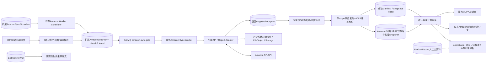
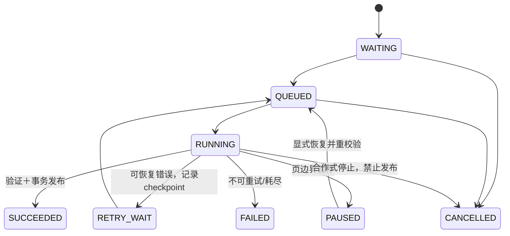

# 后端架构与数据模型草案（待评审）

本文件是逻辑/契约设计，未更改Prisma或生产行为。跨模块、权限、存储与性能影响必须在Phase1实施前按AGENTS评审；本草案不是隐含批准。

## 1. 架构与权威边界

PostgreSQL保存计划、任务、状态、水位、数据及质量事实；Redis只作派发和限流/调度辅助，丢Redis可从DB恢复，不承担业务事实源。文件经既有storage adapter和FileObject引用，不把报告二进制或完整payload放Redis，不新增独立存储服务。

现有ProductRecord/Summary/Text/DetailService主读不切换，不新增商品读模型，不写ProductRecord。Amazon标准化域数据是外部事实；SKU映射显式、可审计。赛狐/人工/Amazon以source和metricDefinitionVersion分开，币种分开；不混加同一指标的多份来源。

## 2. 最小模型演进

**复用实体，不按建议名字机械新增九张同义表。** UI可称Plan/Task，物理表继续Schedule/Run。下列字段是内部草案，非Amazon响应字段。

所有执行/数据实体包含或通过受复合约束的父实体唯一获得 `organizationId + workspaceId + authorizationId + amazonSellerId + sellerAccountId + marketplaceId + dataDomain + source`；normalized数据另有taskId/sourceRunId、syncedAt（采集完成时刻）、sourceUpdatedAt（仅真实提供时，否则NULL）、版本。作用域不存在则任务阻断，不使用NULL/空站点串联。组织来自可信身份，不接受请求自报organization。平台级静态DomainDefinition不含租户资料；由tenant DataSource承载配置与状态。

| 逻辑模型 | 物理建议/最小字段 | 约束和用途 |
| --- | --- | --- |
| Authorization | 扩展AmazonIntegrationSecret及Connection，逻辑授权实体 | 移除provider全局唯一前先迁移；按org/workspace/seller/region/授权实例唯一；多region endpoint分别路由；密文带keyVersion和AAD版本，Secret不返回前端 |
| SellerBinding | 扩展原表，加authorizationId、revision | 复合FK保证授权与ERP店铺同org/workspace，active和站点验证；本地enabledDomains区别于已实测capabilities |
| AmazonSyncPlan | 扩展AmazonSyncSchedule | id/name/revision/status/domain/mode/频率/时区/范围/priority/retryPolicy/retentionPolicy/窗口及补偿/nextRunAt；子scope表规范化多店铺多站点；同一scope可不同模式，但同模式有效计划冲突需阻止 |
| AmazonSyncTask | 扩展AmazonSyncRun | planId/version、parentBatchId、上述单scope、trigger、mode、windowStart/End、status/stage、queuedAt/startedAt/finishedAt、attemptCount/heartbeatAt/leaseOwner/leaseExpiresAt/fenceVersion、cancelRequestedAt、各计数、progress、retryAfter、errorCode；旧resource保留映射 |
| TaskAttempt / Log | 新增运行尝试/结构日志，避免JSON无限长 | taskId/attemptNo/eventAt/stage/page/processedCount/API operation/status/requestId/errorCode；统计数按attempt累积；token/PII/raw body禁入日志 |
| Cursor / Checkpoint | 新增AmazonSyncCursor及任务checkpoint | 独立scope＋mode/stream/version唯一；committedWatermark与inFlightPageToken分开；CAS revision；token加密不暴露；任务页token过期回退安全时间窗 |
| DataSource | 新增租户配置/能力状态，静态域定义在代码 | 范围＋domain/adapterVersion/capabilityStatus/freshnessPolicy/activeSnapshotId/lastSuccessfulTaskId/coverage；不再复用全局connection.lastSyncAt表示所有域 |
| Snapshot / Manifest | 保留库存/刊登Snapshot；新增通用运行manifest/head | 每scope发布版本、task、rowCount、paginationComplete、coverage、validationVersion、checksum/file引用；head只指已发布版本。真实空快照也有manifest，不依赖max(row.capturedAt) |
| Error | 优先复用TaskAttempt.errorCode与Log | 不额外建同义AmazonSyncError；如将来需跨任务incident再评审。错误分类AUTH/THROTTLE/TRANSIENT/SCHEMA/INCOMPLETE/CONFIG等 |
| Report | 新增AmazonSyncReport | 单scope/任务、reportType、requestFingerprint、reportId、documentId、remoteStatus、localStage、日期窗口/选项、nextPollAt、fileId、parse/validate版本/校验和；reportId只与seller组合唯一，不能全局唯一 |
| QualityIssue | 新增AmazonSyncDataQualityIssue | scope/task/snapshot/rule/version/severity/firstSeenAt/lastSeenAt/status/受影响范围/建议；fingerprint去重；acknowledged不等于resolved，源数据恢复才解决 |
| Domain事实 | Phase2/3逐域新增 | 订单/订单行/销售流量/货件/财务等独立业务键，不用一个巨大JSON表代替所有查询；版本/来源/币种/coverage可追踪 |

计划本身可以覆盖多个scope，不伪造单sellerId；在plan-target及展开出的task上强制单scope。跨站点报告如有必要先保留真实marketplaceIds，只有能确定归属的行才能落单站点，否则隔离为质量问题，不复制到每个站点。

索引候选：task(scope,domain,status,queuedAt)、(org,workspace,finishedAt)、(planId,scheduledFor)幂等；partial unique active-slot(scope,domain,stream)限制活动任务；cursor(scope,stream,version)；report(scope,reportId)；quality(scope,status,severity,detectedAt)。具体索引先EXPLAIN/容量测试，避免无依据加索引。

## 3. 调度、队列及并发

1. Scheduler使用持久nextRunAt、短事务claim及计划revision，展开单scope任务；DB先保存任务/dispatch intent，提交后入BullMQ。队列失败保留可重新派发状态及错误，不制造永久BLOCKED孤儿。BullMQ jobId绑定task＋attempt/dispatch版本，保留已有task幂等。
2. 手动/定时共享相同scope slot；相同幂等键同scope返回同任务，不同payload拒绝。计划每个scheduledFor唯一；错过多个周期按计划coalesce，回填明确窗口而非无限堆积。调度分页扫描避免旧100条长期挡住后续。
3. 活动锁精确到org/workspace/authorization/seller/marketplace/domain/stream；并行stream是否可共享写入必须定义，安全默认同域scope一个publisher。API预算按seller＋operation共享，不能因不同marketplace/domain就突破同一Amazon配额。
4. 实时P0/P1与回填使用受控配额/有限页时间片；不能仅靠BullMQ priority（并发1时已执行的大任务不可抢占）。回填每片保存checkpoint重排，保证实时可进入；权重和最大等待由benchmark评审，不写死高并发。
5. Worker领取lease/CAS，按页heartbeat；提交数据和推进水位时验证fenceVersion。旧worker即使复活也不能发布。恢复器检查lease超时，不单凭startedAt终止长任务。取消在页边界停止且不publish、不推进；可恢复暂停保留checkpoint。
6. 暂停计划只停未来生成；暂停任务是checkpoint后PAUSED（内部控制态），UI展示等待执行＋“已暂停”；取消终态CANCELLED。未来恢复显式重校验权限与凭证版本，不偷偷撤销或停止Amazon已在生成的报告。
7. Worker继续读取租户/工作区/店铺启用状态与授权版本，不能仅相信创建时权限；授权撤回、解绑或配置改变会阻断未执行任务。机器计划使用经授权的service principal或现有更新者身份策略，必须明确，禁止离职用户无限保有执行能力。

## 4. 增量、快照发布和恢复

- 每任务固定upperBound，lowerBound=已提交水位减可配overlap；窗口用UTC存储，站点业务日与IANA时区显式记录。不能用上海日期代替所有站点日；原有上海补货分支不暗改。
- 网络成功→解析/白名单→幂等stage upsert→checkpoint同事务；页token是任务续页信息，不是长期域水位。源不提供更新时间时保持NULL；使用报告日期/postedAt仅作相应语义窗口。
- 全部页、订单必要子数据、下载/解析/校验完成后，原子发布manifest/head及推进committed watermark。失败保留已验证checkpoint及旧成功head；报表等待不推进。
- normalized upsert按业务主键及可信sourceUpdatedAt防旧覆盖新；相同timestamp冲突用版本/摘要及确定性复查，不拿syncedAt当来源更新顺序。无sourceUpdatedAt的窗口重取使用任务版本CAS与串行发布。
- 快照仅在完整快照时替换scope全体，缺失SKU才可表示移出当前；增量页面没出现SKU不能删除。源响应格式异常、token循环、超范围/超行限制不得“成功空结果”。真空成功manifest必须通过分页和响应结构验证。
- 被中断时重取当前未提交页；token过期/失效从已提交安全窗口重开，幂等写避免重复。父批次状态由子scope结果派生；部分成功不可提升失败scope新鲜度。只重试失败scope/窗口，避免整批重复抓取。
- 保留逻辑：current/head引用、运行中、未解决issue及审计保护版本不清理；分批TTL清理非当前历史和脱敏raw，记录删除审计。保留天数不冒充Amazon官方要求，先按容量/组织策略评审。

## 5. 任务与报告状态机

任务内部状态：WAITING、QUEUED、RUNNING、RETRY_WAIT、PAUSED、PARTIAL_SUCCESS（父批次）、SUCCEEDED、FAILED、CANCELLED、BLOCKED。外部UI七类映射：WAITING/RETRY_WAIT/PAUSED/BLOCKED→“等待执行”并显示原因；其余对应排队/执行/部分成功/成功/失败/已取消。BLOCKED保留为可筛选原因，不抹掉旧API已有状态。

报表本地状态必须完整：REQUESTED → IN_PROGRESS → READY → DOWNLOADED → PARSED → VALIDATED → COMPLETED。另含REQUESTING（请求响应未知）、RETRY_WAIT、FAILED、CANCELLED及人工核验的NO_DATA处理，不假装全都线性无故障。

| Amazon远端状态（官方Report.processingStatus） | 本地阶段 | 成功判定 |
| --- | --- | --- |
| createReport返回reportId / IN_QUEUE | REQUESTED | 任务仍执行/等待报告 |
| IN_PROGRESS | IN_PROGRESS | 持久nextPollAt，释放worker槽位，延迟job恢复 |
| DONE且documentId可用 | READY | 仅生成完成，未下载/未成功 |
| 文档完整存storage且checksum/大小通过 | DOWNLOADED | 不暴露签名下载URL；过期通过getReportDocument刷新 |
| 格式/编码/压缩解析完成 | PARSED | 中途解析失败不得用部分行发布 |
| schema/日期范围/覆盖/关键键检查通过 | VALIDATED | 尚需本地发布 |
| 事务写入manifest/head/水位成功 | COMPLETED | 该scope任务才能SUCCEEDED |
| FATAL | FAILED/可配置重申请策略 | 错误分类，不无限重复create |
| CANCELLED | CANCELLED/待判NO_DATA | Amazon也可能因无数据取消；不能一概视故障或一概成功空数据，须按报告定义及证据判断 |

createReport后网络丢响应可能已在远端创建：先以seller/type/窗口/options匹配已有报告并审查候选，禁止未知结果直接无限重建。系统生成结算报告从发现READY进入下载分支，不虚构“已申请”。报告raw规范化前执行最小字段策略；可能含PII的财务/退货等文件不默认保留原件，启用前先核验最小字段/合法保留范围。

## 6. 限流、日志与数据安全

- 按官方各operation usage plan及返回可用 `x-amzn-RateLimit-Limit` 信息调度；该头不保证总有，也不代表完整burst/所有预算。缺头用已核验保守策略，不猜QPS。429、5xx、网络/timeout可退避＋jitter，支持可用Retry-After；403/invalid_grant要求授权修复，不重试风暴。
- 请求/限流/重试/等待时间计入持久attempt；区分队列延迟、实际执行时长、Amazon报告等待、下载/解析时长，不能从queuedAt算成API执行耗时。
- 统一可追踪ID：task/attempt/scope/operation/requestId；结构日志脱敏，错误码与短原因；不得记录token、Authorization、buyer字段、签名文档URL或完整响应。journal也执行同样规则。
- LWA token服务端短缓存按authorization/version隔离；密文有keyVersion、AAD scope、加密轮换可审计。官方endpoint区域白名单和报告下载URL校验、防重定向到内网、流式大小上限/解压比防护纳入实现安全检查。当前任意HTTPS endpoint校验不足以证明SSRF防护。
- MCP默认只读落库，记录来源/coverage/asOf/口径版本/缺失原因。显式同步工具仅创建task返回ID，有单独write/trigger权限、审计及幂等，不允许读取工具暗中触发同步或获取Secrets。

## 7. 兼容迁移与回滚草案

1. Expand：新增可空字段/授权实体及新表；旧run/resource/API继续可读；不重命名删除现表，不直接更改现有密文AAD。
2. 只读盘点旧凭证和Seller绑定：唯一合法映射才回填authorization；密文按旧AAD解密受控重加密，保留版本与回退读取。只有验证新复合约束后才解除provider全局唯一。多授权启用后不能回滚到单凭证旧执行器，只能关闭新调度并保持只读。
3. 旧多绑定run保留历史：可从summary/outcomes和snapshot证明的scope建立legacy manifest；缺卖家/站点数据保持legacy/unknown，不猜。旧快照无店铺ID不纳入新scope head。旧计划展开目标前展示范围并确认，不默认启用全量组织计划。
4. Feature gate按org/workspace试点；先停用该范围旧调度、drain旧任务，再启新任务。读取与scope head切换一起验证；不能新旧调度同时写同域。
5. 性能：更多任务/日志/raw/索引增加PG/Redis/API/磁盘负担；先测1k/5k/10k SKU和多店铺并发，记录P50/P95/P99、内存、连接、队列等待、存储增长。以当前路径为基线，关键读路径P95回退超过评审预算（建议10%，待确认）即阻止切换；不为此强加Redis详情缓存。
6. 回退关闭新计划/dispatch，合作式停止新任务并保留checkpoint，应用退到兼容读版本；保留数据库扩展、密文和文件。数据库迁移只向前，不migrate down、不重放生产数据。详见交付计划。
