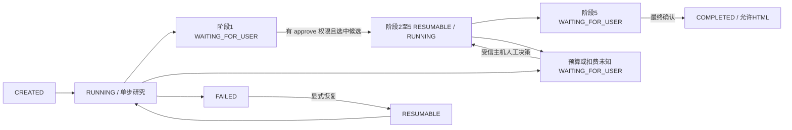

# 本地 AI 选品核心：实现与验收边界

账号说明：Lili 已并入 ERP，沿用当前 ERP 账号、登录会话和权限，无需另行注册或登录 Lili。本文提及工具注册表，是 MCP 工具目录的技术概念，不是账号注册要求。选品页与 API 提示已同步澄清；真实市场工具联调和预算验收仍单独保留。

日期：2026-11-06。报告与代码由 Codex 根据本地源码审阅编写；没有调用多宝鱼服务生成本文，也不使用其品牌署名。

## 本轮授权及范围

### 2026-11-07：Codex 原生 MCP 参数兼容修复

`research_step.action.arguments` 和 `action.result` 接受 JSON 对象，也兼容原生客户端传入的一层 JSON 字符串。MCP bridge 与现有 HTTP 命令入口共用 `action-input.ts`，在记录动作、计算审批指纹之前解码；字符串限制 64,000 UTF-8 bytes，拒绝非法 JSON、数组、null、基本类型、双重编码和凭证。对象仍须通过当前运行目录的工具 schema，不能放宽供应商字段校验或新增审批权限。

非法动作返回明确的 400 输入错误，不修改任务。工具字段校验失败保存 `RESEARCH_TOOL_ARGUMENTS_INVALID`，仅本机校验器生成的受限字段路径进入 `validationFeedback.path`；页面显示路径，不显示参数值、未知字段名、供应商异常正文或凭证。已有失败记录保留历史错误，显式恢复后重新提交即可生成新的预览；恢复和预览均不发送市场请求，付费 dispatch 仍需原有人工审批。

账户调用额度、每任务每来源预算及每工具政策上限是独立约束。账户设置为 10000 不会修改既有任务的 8 次预算，亦不授权付费请求；本修复不调整额度、预算、存储模型、worker 或配置。撤销本段关联代码补丁即可回滚；已保存研究记录不删除。部署仍需单独授权。

回归覆盖：对象原样传递、字符串精确解码、complete 兼容、畸形/超限/嵌套编码拒绝、凭证拒绝、字段诊断、恢复后预览指纹及未批准零 dispatch。运行 `npm run check:fast`；真实任务验收仅恢复指定任务并准备审批预览，不代用户批准、不自动重试未知已发送请求。

本次接入验收（2026-11-07）：现有美国站萨克斯背带任务通过原生 `research_recover` 与 `research_step` 从 FAILED 恢复至 WAITING_FOR_USER / MCP_CALL；原字符串参数已规范化为对象，待审批 `sellersprite__asin.list`，修订14，付费调用0、approved=false。该结果验证真实持久化与目录到审批预览，未验证供应商业务响应及扣费。16项针对性回归通过；全测试1214项中1213项通过，`amazon-sync-center.test.ts` 的 automaticResources 断言失败，本修复未修改该测试或同步资源清单，不能据此宣称全量检查通过。

用户已批准：新增独立选品页面与专用 API，复用现有登录、组织/工作区权限及 AgentExecution/FileObject，不改 Prisma 表结构、不启动真实外部调用，验证仅使用隔离样本。

入口 `/agents/selection-research`，从 `/agents` 进入。没有重构 ERP 导航或 Lili 页面，没有修改现有 Skill、MCP 服务、凭证或运行配置。工作区原有 Amazon Ads、Lili、Prisma 等并行变更不属于本次交付；不能将整个工作区误归为本任务。未 commit、push、部署、迁移或启动真实研究任务。

## 核查事实

五个精确名称的 Skill 在 `~/.codex/skills/<name>/SKILL.md`：amazon-niche-finder、amazon-product-research、amazon-review-analyzer、tariff-calculator-amazon、amazon-product-selection。读取完整正文、绝对路径、SHA256 和声明工具；不替换为 duobaoyu 镜像，不执行其中脚本，也不自动安装服务器版本。这些简版正文写有沙盒样本；用户要求的真实研究必须覆盖其样本使用要求，不能将样本当实测行情。

本地 Lili 源码 `/Users/chenjieliang/Documents/lili`：

- `/src/app/api/mcp/route.ts` 从运行数据库 ToolDef 列工具，提供 initialize/tools/list/tools/call；静态 data/tools.json 是发货定义，不能证明数据库或远端已注册。
- `/src/lib/tool-config/provider-executor.ts` 映射 market_find_products → product_research、market_get_asin → asin_detail、market_get_reviews → review、market_research_keyword → keyword_research 等，并在调用前检查远端实际注册。
- 西柚通过 market_list_xiyou_tools / market_query_xiyou 路由，运行时检查远端工具；不能从定义推断可用。
- Sorftime 执行器明确返回 provider_executor_unavailable；market_scan_node、competitor_find_similar 等无直接映射。finance_get_fee_estimate、data_query 没有因为存在目录定义就成为可用的实时费用/关税接口。
- 本轮没有查询真实实例注册表，没有验证远端配置或连通。既有 Codex 配置远程 HTTP 地址不能直接当作安全可用 ERP 连接；新客户端仅允许 HTTPS 或 loopback HTTP，禁止 URL 携带凭证。
- 主 ERP `src/lib/lili` 当前为目录/元数据能力；本模块不把其 501 未映射响应伪装为真实数据。

## 已实现

`src/lib/selection-research` 为独立核心：

- `skills.ts`：只读 Skill 快照，防路径跳出，不修改源文件。
- `engine.ts`：五阶段、运行状态、调用记录、增量保存、两个人工门禁、预算和扣费核对。
- `schema.ts`：受限 JSON Schema 校验；未知工具/参数或不支持约束拒绝执行，不猜参数。拒绝凭证字段和 MCP 文本内 JSON 凭证。
- `lili-transport.ts`：真实协议客户端、协商、会话、分页目录、匹配 JSON/SSE、请求超时/响应限额、禁止重定向；保存完整匹配的 JSON-RPC 信封。只写了客户端，没有修改或启动 Lili 服务。
- `ai-agent.ts`：复用现有 AI endpoint/headers/fetch；凭证仅在 HTTP headers。尚未做真实模型请求；ERP 当前不实例化 live agent。
- `fixture.ts`：显式隔离样本，不包含虚构市场数字。live 出错不会降级到此 fixture。
- `file-store.ts`：仅本机 CLI 的私有目录适配器；0600 文件、0700 目录、原子替换、fsync、互斥锁。死进程锁必须显式恢复；权限不安全或活锁拒绝。
- `lease-store.ts`：持久 CAS 租约，不跨外部请求持有数据库 transaction；120 秒租约，过期可接管，旧 worker 无法覆盖新版本。一次 step 最多一次模型 action / 一次市场调用，调用前保存 IN_FLIGHT。
- `prisma-repository.ts`：使用既有 AgentDefinition + AgentExecution，完整原始证据保存在 output 中，context 保存 namespace/CAS version/lease。未建表。HTML 经既有 storage adapter + FileObject 保存，不公开 storage URL。
- `economics.ts`：显式同币种单件输入，计算到岸、利润、利润率和盈亏平衡广告费；不补默认税率、FBA费或广告费。
- `report.ts`：静态单文件 HTML，目录、表格、预算 SVG、证据折叠、来源/查询时间/Skill 哈希/审批记录、打印样式。默认无第三方署名。图片可由已授权调用方提供已关联证据的 PNG/JPEG/WebP 内嵌，未自动下载真实竞品图片。

数据市场在 Run 上固定，每次调用有 stage/skill/projectId、服务/provider、参数与当时 schema、请求/响应时间、原始响应、状态、计费性质、预留/已知积分、重试次数（当前固定为0）。actions 保存模型动作与阶段结果，区分 observed/calculated/estimated/assumption；计算需要公式，观察需要成功证据。

## 工作流及安全边界



CREATED/RUNNING/WAITING_FOR_USER/RESUMABLE/COMPLETED/FAILED/CANCELLED 全部支持。阶段1结果要求3至5个候选；服务器确认候选存在后才能进入阶段2。阶段3要求1,2,3与4,5两组评论调用。阶段4缺少可信当前关税核验时必须记为待验证假设；仅有模型提供的日期和 URL 不够，observed tariff 默认拒绝，需要主机独立 verifier。阶段5不允许带未解决估算/假设直接 GO。

模型仅能 call/complete，不能调用 decide、改预算、审批、SQL或业务写操作。当前允许集合是审核过的只读 Lili 工具名，并与运行实例目录和主机工具政策取交集。data_query 和 market_query_xiyou/sorftime 这类任意嵌套工具不开放给模型，后续需要专用只读子工具映射和第二层计费控制，不能直接放行。

付费政策（provider/是否付费/每次预留积分/价格来源/阶段/次数）必须由受信主机提供，模型无权更改。不同 provider 预算独立，不跨货币或积分相加。研究任务首次付费请求经页面批准后，保存 task-scoped grant、操作者、时间、首个动作指纹、各 provider/tool 上限和已批准工具 schema digest；同一任务中的后续付费只读调用复用 grant，但各调用仍独立保存参数、授权 ID、响应、dispatch 状态和 UNKNOWN/CONFIRMED 费用状态。授权仅限当前 Run，不能跨任务、owner、organization 或 workspace；历史任务不会把旧单次审批扩大成任务级授权。成功响应的实际费用可继续保持 UNKNOWN 且不阻断后续请求，若请求/响应状态不明则暂停核对，绝不自动重试。达到冻结的任务次数或账号余额硬上限时不发生 dispatch，也不弹出额度增加审批或自动扩额。工具 schema 变更会撤销 grant，恢复后需重新审阅；选品方向、最终结论等业务门禁保持人工确认。

## ERP 页面/API

| 路径 | 权限 | 行为 |
|---|---|---|
| GET /api/selection-research | agents:view | 最近30条本人、组织、工作区任务 |
| POST /api/selection-research | agents:create | 只接受 mode=fixture，加载本地 Skill 创建任务 |
| GET /api/selection-research/:id | agents:view | 读取同作用域完整任务 |
| POST /api/selection-research/:id | agents:edit / approve / export | step、recover、cancel / decide / export |
| GET /api/selection-research/:id/report | agents:export | 两次确认后下载独立 HTML |

session 决定组织与操作者，workspace 必须通过既有 access 校验。任务仅创建人可见/操作；即使具备 approve 权限也不能审批他人任务。决定记录操作者、时间与唯一 gate id，旧 gate 重放被拒绝。客户端不会提供可信 role 或 approved=true。浏览器“继续”执行有限连续 step，到门禁停止；关闭页面不继续后台运行，但保存状态可以恢复。**没有新 worker/后台调度**。

复用表同时做最小防旁路修补：通用 Agent 列表及动态详情/执行不暴露 selection-research-v1 命名空间；通用文件列表、商品文件/结论/Workbook 下载及商品图片签名接口排除 selection-research/ 文件。其它业务记录行为保持原状。回滚应先禁用新入口/API，保留研究记录和文件，再还原这些命名空间过滤；不得在保留敏感研究记录时移除隔离过滤。

## 本地操作与验证

不修改 package.json，无需安装依赖。CLI 固定 fixture 模式，不读取 .env，不自动连接数据库/外部 MCP：

```bash
node node_modules/tsx/dist/cli.mjs scripts/selection-research.ts create --root /tmp/my-private-research --requirement '美国站宠物用品，隔离流程验证'
node node_modules/tsx/dist/cli.mjs scripts/selection-research.ts drive --root /tmp/my-private-research --id <任务ID>
# 从输出取得 gate id 和候选 id，人工确认；再次 drive 到最终门禁
node node_modules/tsx/dist/cli.mjs scripts/selection-research.ts decide --root /tmp/my-private-research --id <任务ID> --decision '{"kind":"SELECT","gateId":"...","candidateId":"fixture-1"}'
```

final 使用 kind=CONFIRM；report 将 HTML 输出到 stdout，由操作者明确重定向到新文件。show/context 供 Codex 查看已保存状态。recover 只恢复失败状态，不清除未知调用；recover-lock 仅在明确原进程死亡时解锁。

测试使用临时目录、构造 Skill 与 transport，不加载生产凭证。Playwright 对 selection.invalid 全路由拦截，调用真实引擎但不访问 Next 实例、数据库或外网；覆盖创建、两门禁、刷新恢复、下载、切换工作区清空。

运行命令：

```bash
node node_modules/tsx/dist/cli.mjs --test tests/selection-research.test.ts
node node_modules/@playwright/test/cli.js test --config tests/browser/selection-research.config.ts
node node_modules/typescript/bin/tsc --noEmit --incremental false
```

## 未验收与后续门槛

本交付是可恢复核心及隔离 ERP 路径，**不是已完成真实市场研究的自动化系统**。尚未执行真实 PostgreSQL 集成、真实身份端到端、Lili 实例 tools/list、付费工具、AI 模型联调、生产构建或部署。专用 Next API 已用 mock Prisma 和隔离签名会话验证，不能替代真实数据库验收。需要用户确认专门测试环境后，再运行真实数据库持久化/并发/权限验收，不可在开发中猜测已部署模型存在。

本轮验收：14项核心测试、1项专用 API 测试及18项相关既有回归通过，共33项；1项隔离浏览器流程通过；全项目 TypeScript 与本次涉及文件 ESLint 通过。按最小验证路线未运行全量 check、生产构建、真实数据库测试及部署；合码/发布前需要再完成对应检查。测试覆盖流程、安全边界与恢复行为，不证明 AI 结论或真实市场数据的正确性。

当前证据是完整持久快照，单任务上限16MB，AI 上下文上限180k字符，不截断补造；原始响应较大会失败并保留已落盘的 IN_FLIGHT 状态。达到此规模后，应先评估 FileObject 分片不可变证据与摘要索引，获批后改持久层，不能无限扩大 JSON。运行目录页不是后台 worker，浏览器关闭后只恢复已保存任务。

后续按顺序：指定隔离 PostgreSQL环境验收现有表适配器；授权只读实例元数据发现并保存真实工具 schemas；核对 SellerSprite/西柚计费单位和失败扣费语义；核实评论数据和当前税则来源；授权小预算真实测试；再接后台 processor 与多用户审阅。Sorftime未实现、嵌套西柚路由、费用与当前税率来源、自动竞品图片采集均须单独完成。所有原始市场数据目前为空，报告只会标明隔离样本。

## 2026-11-08：研究任务首次付费授权

用户确认：具体研究任务首次付费请求在页面审批后，授权该任务内后续已接入的付费只读请求在保存的 provider 与 tool 调用上限内自动执行。授权绑定现有 Run、owner、organization、workspace；不跨任务传递。首次决定保存授权 ID、操作者、时间、首个请求指纹及冻结的 provider/tool 调用上限；每笔付费调用保存自己的参数、provider、状态、费用状态、授权 ID 与首笔/后续标记。历史 Run 没有该授权字段时继续采用原逐笔审批行为；已记录的旧单笔审批不回溯扩大。

任务级授权不提高调用预算、不跳过账号调用余额账本。单工具/单来源任务上限到达时任务停止，不弹额度增加审批、不自动扩额；账号余额不足则请求不发送。成功响应的请求费用金额仍可能为 UNKNOWN，会留在逐笔记录中但不阻断任务；发送或响应结果实际未知时暂停并要求对照供应商记录核实，禁止重放。阶段候选选择、最终结论和报告确认仍是独立业务门禁。

数据继续存放在既有 AgentExecution output JSON，不增加 Prisma 表或迁移。回滚代码可恢复未来调用的逐笔审批；已发出请求、供应商扣费及现有审计记录不因代码回滚撤销。此补记覆盖旧文档中的逐笔付费审批默认描述，旧运行记录保持原行为。

## 2026-11-08：对话确认入口

用户已明确要求研究确认在聊天完成。新增受独立凭证授权与 agents/approve 约束的 research_confirm，复用现有 decide 路由，在当前 gate/revision 上记录明确的人类回复；无需返回浏览器。细分选择、最终结论、首次付费（无保存授权时）及异常费用核对均可走此入口。确认不会直接发送市场请求，也不能提高已冻结的额度。旧文档中“MCP 没有审批入口/必须到页面”描述由本段替代；已有页面保留。授权、验证和回滚边界见 docs/lili-chat-confirmation-2026-11-08.md。
