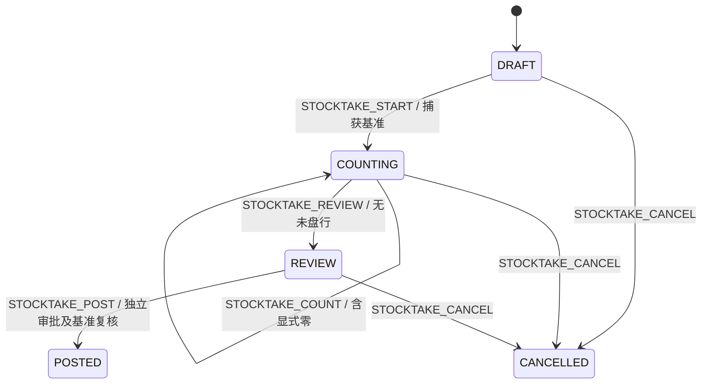

# WMS 能力、状态、异常与事件契约

更新：2026-11-12。依据当前工作树，保留 `src/lib/wms/`、Route Handler、现有组件与 Worker 边界，不为 DDD 重排目录。本文补充历史证据索引与变更单；源规则的 VERIFIED 与目标实现/隔离测试/真实库迁移分别判断。

当前核心实施与本机迁移记录见 [WMS 核心移植落地记录](wms-core-port.md)。下表中“未实现”“仅 Schema”等为本轮升级前基线；新增在途、转换/冲销、耗材、仓库资料及历史/周转查询以该记录及当前代码为准。

## 能力映射

WMS-01…10 的源路径、方法和行号沿用 [P0-B 规则证据](p0b-wms-change-list.md#已核实的源规则和-erp-差异)。全部 32 张候选源表的处置见[逐表映射](wms-table-reuse-review.md#逐表映射)，不是“30 张目标表”。

| 能力 ID | 源依据 | 当前目标与入口 | 完成范围／缺口 |
| --- | --- | --- | --- |
| CAP-01 仓库、区域、库位 | WMS-01/08；warehouse、warehouse_shelf | `catalog-service.ts`、`repository.ts:activeLocation`；warehouses/areas/locations API | 范围外键、启停、余额非零禁止停用；货柜树、尺寸/容量及地址类型未覆盖 |
| CAP-02 库存统一写入 | WMS-02/03/08；inventory、inventory_record、shelf_inventory/opt_record | `application-service.ts` → `repository.ts:move` | 位置+批次唯一余额、非负数量桶、revision、只增流水；不引入 ishungry 负库存开关 |
| CAP-03 收货、质检、上架 | WMS-04/06；inwh_form/entry | `receipt-service.ts`、`receipt-draft-service.ts`；receipts/commands API | 单次收货、分批质检/上架、短收、拒收数量；独立质检链是目标设计，不宣称源系统同义；拒收退运未实现 |
| CAP-04 预占至出库 | WMS-05/07；outwh_form/entry | `stock-service.ts`、`reservation-view.ts`；balances/reservations/commands API | 单余额预占、拣货/撤拣、释放、发货；多商品出库单仅 Schema，未连需求分配、审批、发货或页面 |
| CAP-05 即时调拨 | dispatch_form/entry，语义差距见逐表映射 | `prepareTransferBalances` + 统一命令；transfers 查询及调拨流水页签 | 原子双腿即时移库，可跨公司仓，显式同批次；无在途、部分签收、调拨单生命周期 |
| CAP-06 盘点 | stocktaking/item/item_shelf/shelf/warehouse | `stocktake-service.ts`；stocktakes/commands API | 单仓显式位置范围、账面基准、实盘、审核、独立审批过账；数量冲突须取消重盘；无估值或多仓盘点 |
| CAP-07 库位冻结 | warehouse_shelf.isfrozen | `location-freeze-service.ts` + `activeLocation` | 独立原因/审批、冻结门禁、revision；不改变数量与 available 公式，不代表按数量冻结 |
| CAP-08 查询和对账 | WMS-02/08；inventory_record | `query-service.ts`、`reconciliation.ts` | 统一权限/范围、游标过滤、数量对账；逐页结果不代表全仓核对完成，差异不自动调账 |
| CAP-09 权限、审批、幂等 | WMS-09/10；dispatch_form_record 的部分语义 | `access.ts`、`approvals.ts`、统一命令 | 事务内实时授权、禁止自批、摘要/revision/有效期、审计；不复制客户端角色或批准布尔值 |
| CAP-10 可靠事件 | 目标可靠性需求，非源表机械迁移 | `domain-events.ts`、`event-bus.ts`、`event-dispatch.ts`、`event-consumers.ts` | 事务事件、投递记录、BullMQ 恢复；当前仅证据消费者，财务/头程业务消费未因事件存在而完成 |

模型为 18 张 WMS 表：16 业务表（含仅 Schema 的出库头/行）+2 事件基础设施。基础、盘点、领域事件、库位冻结及出库基础迁移已在本会话应用到本机 `amazon_sync_live_local`；不代表服务器部署、真人仓库验收或所有其他模块迁移已完成。历史索引中的 11 模型、尚未迁移等描述保留为当时基线。

## 状态转换与业务前提

所有命令均校验 scope、实时权限、expectedRevision、幂等键。影响库存或冻结的动作默认独立审批；无需审批的集合仅为 PICK、UNPICK、CANCEL、STOCKTAKE_START/COUNT/REVIEW/CANCEL。非法跳转整笔回滚，不用直接改 status 修复。

### 收货与预占

| 动作 | 允许前态 | 结果与规则 |
| --- | --- | --- |
| 编辑草稿 | DRAFT | 仅创建人，提交全部原明细，不换批次；关联采购单后禁止改计划量；修改增加 revision，无改动不升版本 |
| CANCEL | DRAFT | 创建人取消 → CANCELLED；冻结不阻止取消草稿 |
| RECEIVE | DRAFT | 创建人提交；逐行正数≤expectedQty；未选行保持零，单据只收货一次；实物与待检同增，通常 → RECEIVED |
| INSPECT | RECEIVED / INSPECTED | 本次 accepted+rejected>0 且≤待检；待检减、待上架/拒收增；部分质检保持 RECEIVED |
| PUTAWAY | RECEIVED / INSPECTED | 可对部分已检合格物先上架；quantity≤accepted−putaway；同仓 STORAGE；双腿实物守恒 |
| 收货结果状态计算 | 每次收货/质检/上架后 | 所有行 received=accepted+rejected 为检完；检完且所有 putaway=accepted → PUTAWAY，否则检完 → INSPECTED，否则 RECEIVED。零合格且检完可直接 PUTAWAY，拒收实物仍保留 |
| RESERVE | STORAGE 有可用库存 | 新建预占；reserved 增，实物不变；不能以客户端声明绕开冻结/停用 |
| PICK / RELEASE | 有未拣预占 | quantity≤requested−released−dispatched−picked；PICK 增 picked；RELEASE 减 reserved、增 released |
| UNPICK / DISPATCH | 有已拣数量 | quantity≤picked；两者均减 picked；UNPICK 不动余额，DISPATCH 同减 onHand/reserved、增 dispatched |

预占不存独立 status：remaining=requested−released−dispatched；remaining=0 为 CLOSED，否则 picked=0 为 AWAITING_PICK，否则 remaining−picked=0 为 AWAITING_DISPATCH，否则 PARTIALLY_PICKED。闭单不能用新键再次发货；同一合法命令原键重试仍先授权，再返回已存结果。

### 盘点、冻结与审批



- 盘点允许单仓 1–100 个明确位置、最多 100 个位置批次行。开始/过账检查库位可操作；库位被冻结、范围出现新余额或基准数量/revision 改变时拒绝，取消后重盘。当前是基准冲突检测，不是整个盘点期间禁止一切库存操作。
- 实盘低于待检+待上架+拒收+预占合计不能过账。差异为零不造零数量流水；POSTED/CANCELLED 无重开路径。
- 冻结：false → true（LOCATION_FREEZE），解冻反向；两者要求原因、独立审批、当前 revision。同状态命令使用新键拒绝；原键幂等返回。冻结只限启用的仓库/区域/库位；停用库位可解冻，解冻不启用库位。库存操作的 SHARE 锁与冻结 UPDATE 锁序列化。
- 审批：PENDING → APPROVED 或 REJECTED；APPROVED → CONSUMED 与业务成功同事务。有效期 15 分钟；过期是按 expiresAt 计算的不可执行状态，不写 EXPIRED 枚举。批准时复核申请人授权与目标；执行时复核双方授权、请求摘要、业务版本与范围。拒绝仍可用于申请人撤权后的待审申请；决定重试仅确认同一审批人已存决定，不新增授权。
- `WmsOutboundStatus` 的 DRAFT/RELEASED/COMPLETED/CANCELLED 目前只是 Schema 枚举；没有可执行状态转换。不得调用裸 ORM 切状态冒充出库闭环。

## 异常处理与恢复

依据 `src/app/api/operations/wms/_shared.ts`，HTTP 错误体为 `{ "error": "…" }`；当前没有统一机器错误码，调用方不能臆造 code 字段。

| 情况 | 当前响应/行为 | 调用方处理 |
| --- | --- | --- |
| 无数据库登录会话 | 401 | 重新登录；不能传 userId 代替身份 |
| 非法 JSON/未知字段/数量不是合法整数/无效动作 | 400 | 修正输入；数量 1–2147483647，实盘或质检单侧允许显式零，质检合计必须大于零 |
| 无权限、自批、审批不匹配/过期、非本人草稿 | 通常 403 | 不自动换身份或降级授权；恢复权限/重新申请审批后再操作 |
| 对象在当前范围不存在 | 404；部分关联检查为 422 | 按 scope 查找；不回退跨组织/工作区查询 |
| revision/状态/幂等键冲突、盘点基准变化 | 409 | 刷新并审阅新状态；修改请求内容须新幂等键及新审批；盘点基准冲突取消重盘 |
| 数量不足、超限、冻结/停用位置或错误仓库、明细归属错误 | 通常 422 | 修正数量/位置，或完成解冻及相关库存处理；不绕过统一入口直接改余额 |
| Prisma P2002/P2003/P2025/P2034 | 409，返回统一关联/冲突文案 | 刷新核对业务号、关联及执行结果；同一请求网络重试沿用原键，不盲目生成第二单 |
| 未分类数据库/运行错误 | 500，脱敏为服务暂不可用 | 核查日志和已存命令；未知结果先查原命令/流水，不推断“报错一定未提交” |
| 事件消费失败 | 消费事务回滚，单独记录失败尝试 | 遵循下节重试；不删除事件、不修改库存追平 |

命令事务内任一步失败，余额、流水、单据、命令、事件、审批消费及命令审计一并回滚；此前独立事务创建/批准的审批仍保留。传输中断不等同业务回滚。数量更正必须经过明确业务命令；尚未实现的拒收退运/反向单据不以手工改库替代。

## 事件契约

生产者是 `application-service.ts` → `appendWmsCommandEvent`，提交边界为单库本地事务。当前只有一种完成事件，按 payload.action 区分动作，不存在已实现的 `StockReceived` 等独立事件类型。

| 字段 | 契约 |
| --- | --- |
| id / commandId | String；事件 ID 全局主键，scope+commandId 唯一；一个成功命令一条事件 |
| organizationId / workspaceId | String；数据库复合 FK 保证事件与命令同范围，消费者也必须沿用范围 |
| eventType / schemaVersion | `wms.command.completed.v1` / 整数 1 |
| occurredAt | DateTime（JSON 表达为 ISO 时间）；取 command.createdAt，不声称是外部业务发生时刻 |
| payload.action / sourceAggregateId / expectedRevision / actorUserId | 来自已存命令；sourceAggregateId 是请求目标，RESERVE 的结果 aggregateId 则为新预占 ID，两者不能混用 |
| payload.result | 已存命令结果：commandId、aggregateId、revision、movementIds；TRANSFER 额外 targetBalanceId；冻结额外 frozen/reason |
| result.reservationChange | 新产生的 PICK/UNPICK/RELEASE/DISPATCH 命令包含 quantity、before、after；快照含 id、balanceId、requestedQty、pickedQty、releasedQty、dispatchedQty、revision、remainingQty、unpickedQty、workflowStatus |
| payload.movements | 按 sequence 排序的流水数组；包含流水全部正式字段，以及 warehouseId、locationId、lotId、productRecordId；occurredAt 为 ISO 字符串。数量为整数，balanceAfter 为记账后数量/版本快照 |

`reservationChange` 示例（仅展示该字段，ID 为示意）：

```json
{
  "quantity": 2,
  "before": {"id":"reservation-id","balanceId":"balance-id","requestedQty":3,"pickedQty":0,"releasedQty":0,"dispatchedQty":0,"revision":1,"remainingQty":3,"unpickedQty":3,"workflowStatus":"AWAITING_PICK"},
  "after": {"id":"reservation-id","balanceId":"balance-id","requestedQty":3,"pickedQty":2,"releasedQty":0,"dispatchedQty":0,"revision":2,"remainingQty":3,"unpickedQty":1,"workflowStatus":"PARTIALLY_PICKED"}
}
```

- PICK/UNPICK、取消、冻结和部分无差异盘点可能没有数量流水，`movements: []` 仍是有效完成事件。事件与审计不能以伪造零数量流水替代。
- 已存历史命令/事件不回填新字段；新增 reservationChange 是 v1 的可选扩展。消费者遇到缺失不能补零或查询当前预占伪造历史事实；要求该证据的消费者应明确跳过/拒绝并留待处理。
- 事件不含完整原始请求，不保证所有聚合的前后状态快照，也不保证有成本、币种、汇率、科目、物流签收或来源采购单事实。财务过账须另有正式合同及证据，不从数量变化猜金额。
- 历史已存在命令不自动补事件；事件生成失败导致本次业务事务失败。数据库 trigger 禁止 UPDATE/DELETE 事件与库存流水。

### 投递、幂等与重放

`event-dispatch.ts` 从数据库缺失投递记录/到期待重试记录构造 BullMQ 作业；Redis 仅携带 `{deliveryId}`，jobId 为 `wms-<deliveryId>-<attempts>`。事件、投递状态在 PostgreSQL；丢失 Redis 作业可重建。

`WmsEventDelivery` 以 eventId+consumerId 唯一。消费者按 eventType/schemaVersion 匹配；记录行 `FOR UPDATE SKIP LOCKED`，处理业务写入和 processedAt/attempts 确认在一个事务。不能宣称跨网络副作用 exactly-once；外部调用需消费模块自己的 Outbox。

失败回滚消费者副作用后，条件更新 attempts，availableAt 延后 `min(15分钟,1000×2^min(attempts,10))` 毫秒（首次失败约 2 秒），lastError 仅存 `WMS_EVENT_CONSUMER_FAILED`。数据库最多 10 次，耗尽后保留未处理记录；无自动死信重放或人工重试 API。BullMQ 自身 attempts=3、指数退避起始 1 秒，不等于数据库业务重试次数。

不保证同一聚合严格按序交付或全局顺序；使用 commandId、revision、sequence 判定因果，投影消费者自行定义乱序策略。已有消费者 ID 的重复投递不重复落库；新 consumerId 会登记匹配历史事件，因此改变 ID 是历史重放行为，不能用改名随意触发正式业务重做。

当前注册 `wms.inventory-evidence.v1`，从已存命令和流水核对事件后确认，不代表财务或头程已消费。挂载在 `scripts/import-worker.ts`，运行仍经 worker-manager 和 `src/lib/runtime/worker-registry.json`；本次文档更新不启动/重启 Worker。

## 验证与维护入口

| 范围 | 当前验证入口 |
| --- | --- |
| 数量规则/请求/审批按钮 | `tests/wms-rules.test.ts` |
| 收发、事务、权限、并发、幂等 | `tests/integration/wms-first-loop.integration.ts`、`wms-http.integration.ts` |
| 盘点基准及过账 | `tests/integration/wms-stocktake.integration.ts` |
| 冻结与库存锁序列化 | `tests/integration/wms-location-freeze.integration.ts` |
| 成对调拨、分页、跨范围游标 | `tests/integration/wms-transfer.integration.ts` |
| 不变事件、预占快照、回滚/重复消费、BullMQ 恢复 | `tests/integration/wms-events.integration.ts` |
| 出库 Schema 约束 | `tests/integration/wms-outbound-schema.mjs` |

上述为代码/隔离测试入口，不是本次重新执行的验收记录。使用 `scripts/test-wms-schema-offline.mjs` 的已有定向参数，不加载根 `.env` 或真实凭据。本文只做文档和链接校验；未重跑应用测试、性能基线或构建，未迁移、部署或触碰真实库存。
